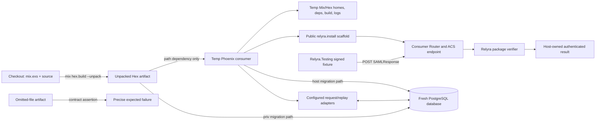

# Phase 74: Clean-Room Package Consumer - Research

**Researched:** 2026-09-24  
**Domain:** Elixir/Hex package boundary, Phoenix consumer integration, Ecto migrations, CI  
**Confidence:** HIGH

<user_constraints>
## User Constraints (from CONTEXT.md)

### Locked Decisions
- **D-01:** Build and unpack the local Hex tarball with `mix hex.build --unpack`, then resolve Relyra from that unpacked artifact in a consumer project outside the checkout. A path dependency on the unpacked package is the simplest deterministic proof of the shipped files; registry/index resolution is not a Phase 74 goal.
- **D-02:** Place the consumer, Mix/Hex homes, dependency path, build root, database, and captured output under task-owned temporary paths. Keep the BEAM toolchain available on `PATH`, but do not inherit checkout build or dependency state. Assert the resolved Relyra source is inside the unpacked artifact and outside the checkout.
- **D-03:** Include a controlled package-omission negative control. It must fail because a required shipped file is absent, with a diagnostic identifying the missing package contract. The successful and negative controls must not load root fixtures, unshipped checkout files, or `Relyra.TestSupport`.

### Phoenix Runtime Exercise
- **D-04:** Go beyond compile or health-route checks: submit one valid signed SAML response through the consumer's real Phoenix router/ACS endpoint and verify the host receives the expected authenticated outcome. Use the package-shipped `Relyra.Testing` fixture helpers (`signed_success/1`, `post_params/2`, `consume_opts/2`) so the real verifier path is exercised without private test support.
- **D-05:** Keep this one deterministic package-consumer success proof bounded. Full rejection, replay, tenant-isolation, diagnosis, and recovery journeys belong to Phase 76; the Phase 74 smoke must not become a second lifecycle suite.

### Migration Ownership
- **D-06:** Run Relyra-owned migrations from the dependency path inside the unpacked artifact; run host-owned request/replay store migrations from the consumer's own migration directory against a pristine PostgreSQL database. Do not copy Relyra migrations into the host app.
- **D-07:** Validate the tables through the configured store adapters, including representative write/read or consume and uniqueness behavior, rather than relying only on table-existence checks. This proves both package migration availability and the documented host/library DDL boundary.

### Installer Drift and Adopter Safety
- **D-08:** Preserve current installer semantics: normal runs leave existing generated files untouched; `--force` remains the explicit, potentially destructive overwrite path. Do not make forced regeneration the upgrade mechanism and do not introduce interactive conflict prompts into CI.
- **D-09:** Keep a deterministic fresh-install generated-tree/receipt comparison and add a consumer scenario seeded from a prior generated scaffold. The fresh golden catches accidental installer output changes; the prior scaffold catches upgrade drift that a golden alone cannot detect. Failures should name the command and the exact file, route, or integration contract that diverged, with a clear next step.

### Compatibility Profiles
- **D-10:** Exercise the clean-room consumer on the repository's current CI tuples, Elixir 1.19.5 with OTP 27 and OTP 28, rather than inheriting older compatibility examples from research prompts as an unsupported new commitment.
- **D-11:** Cover a full Phoenix/Ecto/PostgreSQL consumer profile and a no-optional-dependencies compile profile. Run the migration/runtime proof where those optional integrations are installed; use `--no-optional-deps --warnings-as-errors` for the minimal profile. Avoid a full Cartesian matrix of every optional integration unless the plan shows it is required for PKG-05.

### the agent's Discretion
- Choose the temporary-root layout and exact isolated environment variable wiring, provided all paths are asserted and diagnostics remain readable.
- Choose a stable consumer fixture shape that is generated from Relyra's public installer and can be initialized reproducibly from a prior scaffold state.
- Keep all proof deterministic in a mandatory CI lane; do not add a manual verification gate or alter public API, defaults, cryptographic policy, package API, or other security posture.

### Deferred Ideas (OUT OF SCOPE)
- Full SAML rejection/replay/tenant-isolation/diagnosis/recovery journeys — Phase 76.
- Hosted external consumer twin, registry-resolution round-trip, post-publish parity and scheduled drift checks — later only if local artifact evidence is insufficient or adoption evidence demands it.
- Exhaustive compatibility Cartesian matrix — deferred until adoption evidence justifies the cost.
- No todos matched Phase 74 for folding into scope.
</user_constraints>

<phase_requirements>
## Phase Requirements

| ID | Description | Research Support |
|----|-------------|------------------|
| PKG-01 | A clean-room Phoenix consumer installs Relyra exclusively from the locally built and unpacked Hex artifact. | Hex `--unpack` and isolated path-dependency harness; assert resolved dependency source path. |
| PKG-02 | The consumer cannot access checkout-only files, root fixtures, or private `Relyra.TestSupport` modules. | Package whitelist inspection, checkout exclusion assertions, private-module compile/load negative controls. |
| PKG-03 | A developer can run the installer, compile with warnings as errors, and boot the consumer from fresh state. | Public installer and generated Phoenix endpoint; clean consumer command sequence with captured diagnostics. |
| PKG-04 | A developer can apply Relyra and adopter migrations to an empty PostgreSQL database. | Dependency-path migration runner precedent plus consumer-owned runtime-store DDL and Ecto adapter operations. |
| PKG-05 | The packaged consumer passes representative supported BEAM and optional-dependency profiles. | Existing mandatory CI tuples are Elixir 1.19.5 on OTP 27/28; full Phoenix/Ecto/PostgreSQL and minimal no-optional compile lanes. |
| PKG-06 | Installer regeneration or upgrade drift produces either an intentional compatible result or a precise automated failure. | Existing generated-tree golden and installer non-overwrite behavior; add a prior-scaffold upgrade fixture and exact file/route assertions. |
</phase_requirements>

## Project Constraints (from AGENTS.md)

- Follow the active `.planning/` phase plan; this research is planning-only and does not implement Phase 74.
- Preserve the strict SAML invariant: every login ends in a cryptographically verified assertion or typed rejection.
- Never trust document `KeyInfo`; configured IdP certificates are the only signature source.
- Keep one XML parse path through Saxy/SaxyTree. DTD/entity disabling and size checks remain before Saxy on raw bytes.
- Digest recomputation and `:public_key.verify` remain mandatory; structure-only acceptance is forbidden.
- Trust mutations and audit writes remain co-committed; production replay protection remains cluster-safe, with ETS only as the documented dev/single-node option.
- Do not bypass the crypto, XML, C14N, algorithm-policy, audit-writer, or behaviour seams listed in `AGENTS.md`.
- Do not change public API, published callback signatures, permissive defaults, security posture, or major-version policy as part of this feature-neutral consumer harness.
- All new acceptance criteria require deterministic automated evidence in a mandatory CI lane; no manual-only gates or required UAT artifacts. External services are canaries, not merge gates.
- Preserve separate fresh-process `cmd mix test` security suites, do not weaken `test/security/xml/adversarial_crypto_test.exs`, and retain `mix format --check-formatted`, warnings-as-errors, and `mix ci.security` expectations.
- Conventional commit style applies if the plan includes commits; Release Please owns CHANGELOG generation. Never run `mix hex.publish` manually.

## Summary

Phase 74 should add a disposable consumer harness that builds the exact local Hex package, unpacks it, and runs a generated Phoenix application from a separate temporary root. A path dependency may point only at the unpacked artifact. Mix home, Hex home/config, dependency cache, build root, database state, and captured output should be explicitly isolated and printed on failure; assert `Mix.Project.deps_paths()[:relyra]` lies beneath the artifact and `:code.lib_dir(:relyra)` lies beneath the isolated build root, both outside the checkout. Hex documents `--unpack` specifically as a way to check that a tarball contains the files needed before publishing. [CITED: https://hex.hexdocs.pm/Mix.Tasks.Hex.Build.html]

Keep the proof as two profiles: a full Phoenix/Ecto/PostgreSQL consumer that installs through `mix relyra.install`, compiles with warnings as errors, runs both migration owners, boots the real router, and posts one valid signed response using shipped `Relyra.Testing` helpers; and a minimal `--no-optional-deps --warnings-as-errors` compile profile. Add the package-omission negative control and prior-scaffold upgrade check as separately named contracts. The acceptance remains feature-neutral: do not duplicate Phase 76's lifecycle suite or expand compatibility beyond the existing Elixir 1.19.5 / OTP 27 and 28 tuples. [VERIFIED: `.github/workflows/security-gates.yml:45-54`; quote: `otp: [27, 28]`, `elixir: ["1.19.5"]`; `.github/workflows/demo-app-ci.yml:45-54` repeats those matrix values.]

**Primary recommendation:** Use one repository-root command as the orchestrator for artifact build and consumer profiles, with all app execution outside the checkout, artifact-derived migrations, a fresh PostgreSQL database per run, and explicit contract-level error messages. Keep the harness deterministic and blocking in the existing mandatory security workflow.

## Architectural Responsibility Map

| Capability | Primary Tier | Secondary Tier | Rationale |
|------------|-------------|----------------|-----------|
| Hex package contents and dependency provenance | Package/build harness | CI | Build/unpack the exact tarball and check the consumer's resolved Relyra location. Hex defines `--unpack` as an output-directory mode for inspecting package contents. [CITED: https://hex.hexdocs.pm/Mix.Tasks.Hex.Build.html] |
| Phoenix ACS success exercise | Consumer application | Phoenix.ConnTest harness | The consumer owns the endpoint and host-visible authenticated result; ConnTest dispatches requests to the current endpoint. [CITED: https://phoenix.hexdocs.pm/1.8.2/Phoenix.ConnTest.html] |
| Relyra schema migrations | Packaged dependency | Consumer's Ecto Repo | The plan runs migrations from the resolved unpacked source dependency path. `Application.app_dir(:relyra, "priv/repo/migrations")` is the documented runtime lookup and may name the isolated compiled-app copy; compare its file set to the source. |
| Request/replay storage schema and behavior | Consumer database/repo | Packaged adapters | Host owns the store tables; configured adapters prove actual package-to-schema integration. |
| Installer drift | Packaged Mix task | Consumer scaffold fixture | Fresh installer output and a prior generated tree expose separate new-install and upgrade compatibility regressions. |
| BEAM/optional profile coverage | CI matrix | Local command | Reuse current CI tuples and run required dependency configurations with independent consumer state. |

## Standard Stack

### Core

| Library/tool | Version or constraint | Purpose | Why standard |
|--------------|-----------------------|---------|--------------|
| Elixir / Mix | Project declares `~> 1.19`; CI explicitly selects 1.19.5 | Build, compile, run consumer, fetch dependencies | Current repo contract. [VERIFIED: `mix.exs:9-17`; quote: `elixir: "~> 1.19"`; `.github/workflows/security-gates.yml:53-54`; quote: `elixir-version: "1.19.5"`.]
| Hex | Existing installed Mix archive; no new package | Build/unpack local artifact | Official Hex command produces the artifact and unpacked contents via `mix hex.build --unpack`. [CITED: https://hex.hexdocs.pm/Mix.Tasks.Hex.Build.html]
| Phoenix | Optional dependency `~> 1.8` | Consumer router, endpoint, ConnTest | Already the library's supported integration surface. [VERIFIED: `mix.exs:80-84`; quote: `{:phoenix, "~> 1.8", optional: true}`, `{:phoenix_ecto, "~> 4.6", optional: true}`, `{:phoenix_live_view, "~> 1.1", optional: true}`.]
| Ecto / Ecto SQL / Postgrex | Optional deps `~> 3.13`, `~> 3.13`, `>= 0.0.0` | Consumer Repo, migrations, persistent store proof | Required only in full profile; package already supports these adapters. [VERIFIED: `mix.exs:90-94`; quote: `{:ecto, "~> 3.13", optional: true}`, `{:ecto_sql, "~> 3.13", optional: true}`, `{:postgrex, ">= 0.0.0", optional: true}`.]
| PostgreSQL | Existing CI service `postgres:16` | Empty-state integration database | Current demo/security workflow already provisions this service. [VERIFIED: `.github/workflows/demo-app-ci.yml:14-29`; quote: `image: postgres:16`; `.github/workflows/security-gates.yml:14-29` has the same service.] 

### Supporting

| Tool/pattern | Purpose | When to use |
|--------------|---------|-------------|
| Phoenix.ConnTest `build_conn/0`, `post/3`, `response/2` | In-process request dispatch to real endpoint/router | Full profile accepts valid ACS response and checks host-owned authenticated outcome. [CITED: https://phoenix.hexdocs.pm/1.8.2/Phoenix.ConnTest.html] |
| `Ecto.Migrator.with_repo/3`, `Ecto.Migrator.run/4` | Start Repo and run migrations from explicit source directory | Run package migration directory independently from consumer migration directory. [CITED: https://ecto-sql.hexdocs.pm/Ecto.Migrator.html] |
| `Relyra.Testing` | Generate valid signed response, POST params, consume opts | Consumer fixture invokes public shipped API; no root test support. [VERIFIED: `lib/relyra/testing.ex:1-20, 62-102`; quote: `defmodule Relyra.Testing`, `def signed_success(opts \\ [])`, `def post_params(%Fixture{} = fixture, opts \\ [])`, `def consume_opts(%Fixture{} = fixture, opts \\ [])`.]
| Isolated Mix env vars | Separate per-run configuration/build/deps | Consumer app and dependency state live under temp root. Mix docs identify `MIX_HOME`, `MIX_DEPS_PATH`, `MIX_BUILD_ROOT` / `MIX_BUILD_PATH`, and `MIX_ARCHIVES`. [CITED: https://mix.hexdocs.pm/main/Mix.html#module-environment-variables] |

### Alternatives Considered

| Instead of | Could use | Tradeoff |
|------------|-----------|----------|
| Unpacked artifact as a local path dependency | Local Hex repository or published registry dependency | Those add index/fetch/publish semantics expressly out of scope; path dependency directly proves files from the unpacked package. [ASSUMED: recommendation derived from locked D-01 and target proof boundary.] |
| One end-to-end success and representative store contracts | Full Phase 76 login/rejection/replay/tenant suite | Broader journeys add maintenance and overlap deferred lifecycle scope. [ASSUMED: follows locked D-05/D-07.] |
| Two selected profiles | Full optional-dependency Cartesian matrix | Current requirements need representative profile evidence only. [ASSUMED: follows locked D-10/D-11.] |

No external package installation is required by Phase 74. **Package Legitimacy Audit:** not applicable; keep dependencies to the project's already declared stack.

## Architecture Patterns

### System Architecture Diagram



### Recommended Project Structure

```text
scripts/
├── check_demo_package_exclusion.sh  # existing limited package check; replace/extend
└── check_clean_room_consumer.sh     # proposed one-command orchestration (path/name at planner discretion)
test/fixtures/package_consumer/
├── generated/                       # installer-generated fresh scaffold / golden receipt
├── prior_scaffold/                   # frozen previous installer result for upgrade contract
└── omitted_artifact/                 # controlled missing-file input, no checkout fallback
```

These locations are recommendations, not existing paths. [ASSUMED]

### Pattern 1: Artifact-first isolated dependency resolution

**What:** Build/unpack into a task-owned temporary artifact directory. Generate/copy only the consumer app scaffold outside the repository, declare Relyra by path to the unpacked artifact, and set isolated Mix homes/deps/build paths. Before compile, resolve the Relyra app path and fail if it is outside the artifact or inside the checkout. The resolver should not include root fixture or support paths.

**When to use:** Every full and minimal profile, before fetching/compiling dependencies.

**Example (harness pseudocode):**

```sh
root="$(mktemp -d)"
trap 'rm -rf "$root"' EXIT
artifact="$root/artifact"
consumer="$root/consumer"
export MIX_HOME="$root/mix-home"
export HEX_HOME="$root/hex-home"
export MIX_DEPS_PATH="$root/deps"
export MIX_BUILD_ROOT="$root/build"
mix hex.build --unpack --output "$artifact"
```

Mix documents those environment variables, including that `MIX_BUILD_ROOT` controls the build-artifact root and `MIX_DEPS_PATH` expects an absolute path. [CITED: https://mix.hexdocs.pm/main/Mix.html#module-environment-variables] The exact shell implementation and Hex home variable should be checked against the installed Hex version; do not assume `HEX_HOME` is honored without confirming via Hex docs or a fresh-state probe. [ASSUMED]

### Pattern 2: Dual-owner migrations on pristine DB

**What:** Create one uniquely named database for the profile. Run Relyra's migrations from the resolved unpacked dependency path, then the consumer's own host migration. Exercise configured request/replay adapters with a write and subsequent read/consume plus duplicate uniqueness behavior.

**When to use:** Full Ecto/PostgreSQL profile only.

**Example:**

```elixir
artifact_migrations = Application.app_dir(:relyra, "priv/repo/migrations")

Ecto.Migrator.with_repo(Consumer.Repo, fn repo ->
  Ecto.Migrator.run(repo, artifact_migrations, :up, all: true)
  Ecto.Migrator.run(repo, "priv/repo/migrations", :up, all: true)
end)
```

The discrete module and migration-path values in this example are from the existing guide: [VERIFIED: `guides/production_ecto_path.md:55-60`; quote: `migrations_path = Application.app_dir(:relyra, "priv/repo/migrations")`, `Ecto.Migrator.run(repo, migrations_path, :up, all: true)`.]

This follows the existing guide contract and Ecto's documented explicit migration-source support. [CITED: https://ecto-sql.hexdocs.pm/Ecto.Migrator.html] The consumer must check returned status/errors and must not copy Relyra migrations to its tree. [VERIFIED: `guides/production_ecto_path.md:52-60`; quote: `mix relyra.install` does **not** copy migrations into your host app. Run them from the `:relyra` dependency path.] The ownership split is explicit: [VERIFIED: `guides/production_ecto_path.md:46-48`; quote: `**Host owns:** Store table DDL (`request_intents`, `replay_keys`), thin wrapper modules that inject per-store `repo` and `table`, and the `Connections` delegator`.]

### Pattern 3: Public fixture through real Phoenix endpoint

**What:** Use `Relyra.Testing.signed_success/1`, `post_params/2`, and `consume_opts/2`; route request through Phoenix.ConnTest to the actual consumer router/ACS. A consumer-owned callback or adapter records only the mapped authenticated result. Assert status and host outcome without logging payload/certificate material.

**When to use:** One full-profile happy-path acceptance contract.

**Example:**

```elixir
fixture = Relyra.Testing.signed_success()
conn = Phoenix.ConnTest.build_conn()
  |> Phoenix.ConnTest.post("/saml/acs", Relyra.Testing.post_params(fixture))
```

`/saml/acs` is an illustrative, proposed consumer route, not a repository-verified path. [ASSUMED] ConnTest sends requests to the configured endpoint and documents `post/3` as dispatch to that endpoint. [CITED: https://phoenix.hexdocs.pm/1.8.2/Phoenix.ConnTest.html] The exact result assertion must follow the consumer-owned session/user contract selected by the planner, while keeping all cryptographic trust input explicit and using Relyra's verifier. [ASSUMED]

### Anti-Patterns to Avoid

- **Consumer app nested under checkout:** it can accidentally resolve root fixtures or `test/support`; keep its cwd and all output out-of-tree, then assert provenance.
- **Path dependency points to checkout:** this tests source tree, not package contents.
- **Check for absence only:** an omission control must assert the exact expected missing-package contract failure so unrelated failures do not pass as proof.
- **Table existence only:** it does not prove Relyra/host DDL split or adapter query semantics; include adapter operations and uniqueness behavior.
- **Calling `mix relyra.install --force` as upgrade:** current installer uses force as explicit overwrite permission; normal install intentionally skips existing generated files. [VERIFIED: `lib/mix/tasks/relyra.install.ex:15-23, 48-58`; quote: `force = Keyword.get(opts, :force, false)`, `force or not File.exists?(path)`, `Skipped existing #{path} (pass --force to overwrite)`.]
- **Treating HTTP success as verifier proof:** make sure the fixture submits through the actual ACS router and host receives the fixture's expected verified result, rather than a test-only controller bypass.
- **Expanding into adversarial/replay/tenant workflow tests:** those journeys belong to Phase 76; Phase 74 checks package boundary and one successful real path.

## Don't Hand-Roll

| Problem | Don't Build | Use Instead | Why |
|---------|-------------|-------------|-----|
| Signed SAML fixture generation | Consumer-side XML generator, copied private support, or hand-signed ad hoc XML | Shipped `Relyra.Testing` helpers | Exercises the package API and real verifier while keeping root-only support unavailable. |
| Hex archive format/unpack behavior | Custom tar writer or copy-of-source approximation | `mix hex.build --unpack --output PATH` | Hex's own command builds the package and unpacks its contents for inspection. [CITED: https://hex.hexdocs.pm/Mix.Tasks.Hex.Build.html] |
| Migration tracking and locking | Custom schema version table or one-off SQL runner | `Ecto.Migrator` | Supports explicit migration source directories and version tracking. [CITED: https://ecto-sql.hexdocs.pm/Ecto.Migrator.html] |
| Phoenix request dispatch | Direct controller call or fake endpoint | `Phoenix.ConnTest` with actual Endpoint | Sends request through the configured app endpoint/router. [CITED: https://phoenix.hexdocs.pm/1.8.2/Phoenix.ConnTest.html] |
| Fresh/prior installer output comparison | Broad text snapshots with unclear ownership | Reuse existing generated-tree/golden receipt approach and report exact differing file | Repository already has fixture golden trees and installer behavior tests. [VERIFIED: `test/fixtures/demo_host/golden/` (router, config, adapter files); `test/mix/relyra_install_test.exs:1-150` checks files, route insertion idempotence, and receipts.]

**Key insight:** The contract is the resolved package artifact and the adopter-visible behavior. Root source compilation or a package file-list check alone cannot prove that a fresh Phoenix host can compile, migrate, boot, and verify through only shipped files.

## Common Pitfalls

### Pitfall 1: Checkout leakage invalidates the proof

**What goes wrong:** Consumer resolves local source, test helpers, fixtures, a sibling checkout, or an inherited `deps`/`_build` path instead of the tarball.

**Why it happens:** Running `mix` with the checkout as cwd or reusing environment-local cache paths creates accidental access to private source.

**How to avoid:** Build artifact from checkout root, then `cd` to temp consumer; isolate Mix paths; assert resolved application path is under unpacked artifact; reject all paths under checkout except the initial artifact-build command.

**Warning signs:** `mix deps` reports `path: ../..`; consumer app path or compile output contains checkout root; private support module is loadable.

### Pitfall 2: Stale DB or schema can mask missing migration ownership

**What goes wrong:** Tests pass because prior schema state exists, or host migration accidentally creates package-owned tables.

**Why it happens:** Reusing a shared database or checking only tables after migration.

**How to avoid:** Use a unique database per run (or an isolated PostgreSQL cluster); prove fresh DB starts empty; verify package tables are created from artifact migration path and host store tables from consumer migration path; then call the configured stores and uniqueness constraints.

### Pitfall 3: Runtime fixture does not match consumer ACS configuration

**What goes wrong:** Fixture fails because the package's exact connection, ACS URL, resolver, certificate or request correlation contract was not threaded through normal configuration.

**Why it happens:** The fixture defaults represent a test connection and the consumer app needs its own real host endpoint/adapters.

**How to avoid:** Derive ACS request URL and expected trust context from `Relyra.Testing` fixture, pass `consume_opts/2` into the package's normal endpoint integration, and use the public fixture's configured test cert chain. Keep certificates/response out of logs.

### Pitfall 4: Installer golden does not test upgrade safety

**What goes wrong:** Fresh output remains stable while later installer versions silently leave a stale required integration file or route behind.

**Why it happens:** A fresh generated tree has no pre-existing adopter edits or earlier scaffold state.

**How to avoid:** Seed one fixture with a prior generated scaffold plus adopter-owned modifications, run non-force install, and assert documented preserved/compatible outcome or a clear failure naming the file/route. Retain `--force` overwrite test as separately intentional.

### Pitfall 5: Matrix repetitions share mutable output or database

**What goes wrong:** OTP jobs/profile steps collide on logs, consumers, build dirs, or database names and results become order-dependent.

**Why it happens:** Fixed `/tmp` paths are global and current package script uses `/tmp/relyra-package-check`. [VERIFIED: `scripts/check_demo_package_exclusion.sh:7-8`; quote: `package_dir="/tmp/relyra-package-check"`.]

**How to avoid:** Include PID/random run identifier and profile in the temp-root/database name; cleanup on success; preserve diagnostic log location on local failure and upload only redacted CI diagnostics.

### Pitfall 6: Failed command details are lost or reveal secrets

**What goes wrong:** CI emits only a generic exit code, or debug output prints XML, private keys, cookies, database credentials, or environment secrets.

**How to avoid:** Each phase prints profile, exact command, consumer path, output-log path, expected contract, and a corrective next step; sanitize/truncate captured stderr and redact secret-like values before CI artifact upload. [ASSUMED: operational recommendation from locked Phase 74 specifics.]

## Code Examples

### Hex artifact build

```sh
mix hex.build --unpack --output "$artifact_dir"
```

Hex documents `--unpack` and `--output` as the output directory used with it. [CITED: https://hex.hexdocs.pm/Mix.Tasks.Hex.Build.html]

### Inspect dependency source and compiled location

```elixir
source = Mix.Project.deps_paths()[:relyra] |> Path.expand()
compiled = :code.lib_dir(:relyra) |> to_string() |> Path.expand()
unless String.starts_with?(source, Path.expand(artifact_dir) <> "/") do
  raise "package contract: Relyra resolved outside the unpacked artifact"
end
unless String.starts_with?(compiled, Path.expand(build_root) <> "/") do
  raise "package contract: compiled Relyra escaped the isolated build root"
end
```

The source/build distinction is resolved in Plan 74-01; the selected Mix release still needs an execution-time path check. [ASSUMED]

### Use shipped success fixture

```elixir
fixture = Relyra.Testing.signed_success()
params = Relyra.Testing.post_params(fixture)
opts = Relyra.Testing.consume_opts(fixture)
```

The helper signatures and public module location are quoted in Standard Stack above. Do not add `Relyra.TestSupport` or root fixture paths to the consumer's compiler/load paths. [VERIFIED: `lib/relyra/testing.ex:62-102`]

## State of the Art

| Old/current approach | Phase 74 target | Impact |
|----------------------|-----------------|--------|
| Existing `scripts/check_demo_package_exclusion.sh` only builds/unpacks and checks no `demo/` path; uses fixed `/tmp/relyra-package-check`. [VERIFIED: `scripts/check_demo_package_exclusion.sh:1-28`; quote: `mix hex.build --unpack --output /tmp/relyra-package-check`, `if [ -n "$demo_path" ]`. ] | Build a disposable consumer from unpacked artifact, assert provenance/isolation, compile, run migrations and one endpoint proof. | Package contents become evidence for adopter behavior, not just omission of demo files. |
| `demo/ledger_loop` uses `{:relyra, path: "../.."}` and therefore proves working-tree integration rather than package artifact boundary. [VERIFIED: `demo/ledger_loop/mix.exs:1-65, 82-87`; quote: `{:relyra, path: "../.."}`.] | Clean-room consumer path dependency points to unpacked tarball. | Detects missing package files and accidental reliance on checkout support. |
| Current release parity checks unpacked local artifact membership and private support exclusion, but not full external app boot. [VERIFIED: `test/mix/tasks/verify_release_parity_test.exs:145-174`; quote: `mix hex.build`, `assert Enum.all?(@public_testing_paths, &(&1 in unpacked_paths))`, `refute Enum.any?(unpacked_paths, &String.contains?(&1, "lib/relyra/test_support"))`.] | Add consumer compile/runtime/migration contracts while retaining package list check. | Bridges existing package file guard to Phoenix adopter evidence. |

**Deprecated/outdated:** No third-party package changes or protocol changes are required. Do not interpret existing release-parity registry canary as sufficient evidence for the local artifact consumer: it does not boot a Phoenix app.

## Environment Availability

| Dependency | Required By | Available in research shell | Version/observation | Fallback |
|------------|------------|-----------------------------|---------------------|----------|
| Elixir / Mix / Erlang | Artifact build and all consumer profiles | No selected version | `elixir`, `mix`, and `erl` report “No version is set for command” in this session. | CI matrix / developer toolchain setup must select `.tool-versions`; no local execution attempted. |
| PostgreSQL client / readiness check | Full migration profile | Yes | `psql` and `pg_isready` 14.17; `/tmp:5432 - accepting connections` | CI provisions PostgreSQL service; project workflows use postgres:16. |
| Docker | Isolated database if harness chooses container | Yes | Docker 29.5.2 CLI | CI service container is established precedent. |
| Hex | Build/unpack | Not probed, because Mix is unavailable | — | Installed through `mix local.hex` in CI after BEAM setup. |

Current shell cannot run the Phase 74 artifact because no BEAM version is selected; this is an execution environment limitation, not evidence of project support. The CI workflows positively set OTP 27/28 and Elixir 1.19.5. [VERIFIED: `.github/workflows/security-gates.yml:50-54`; quote: `otp-version: ${{ matrix.otp }}`, `elixir-version: ${{ matrix.elixir }}`; matrix at lines 34-38 is `otp: [27, 28]`, `elixir: ["1.19.5"]`.]

## Validation Architecture

### Test Framework

| Property | Value |
|----------|-------|
| Framework | ExUnit, invoked in the generated consumer via `mix test`; exact harness may also be a repository shell script. |
| Config file | Existing root formatter config `.formatter.exs`; consumer config generated by Phoenix/installer. |
| Quick run command | Proposed `scripts/check_clean_room_consumer.sh --profile minimal` (name subject to plan). |
| Full suite command | Proposed `scripts/check_clean_room_consumer.sh --profile full`; mandatory CI owner must invoke it in its blocking job. |

### Phase Requirements → Test Map

| Req ID | Behavior | Test Type | Automated Command | File Exists? |
|--------|----------|-----------|-------------------|-------------|
| PKG-01 | Tarball unpacks and Relyra resolves only under artifact | integration | Clean-room harness full profile; exact invocation TBD | ❌ new harness |
| PKG-02 | Root/private support inaccessible; omitted-file artifact produces expected failure | integration/negative | Harness provenance + omission contract | ❌ new consumer contract |
| PKG-03 | Installer, compile warnings-as-errors, real Phoenix ACS success from fresh state | integration | Harness full profile | ❌ new consumer app/contract |
| PKG-04 | Artifact migrations and host store migrations run on empty DB; adapters perform operations and uniqueness behavior | integration | Harness full profile with PostgreSQL service | ❌ new consumer migration/runtime contract |
| PKG-05 | Current BEAM tuples and full/minimal profiles pass | CI matrix | Blocking matrix job invokes profile per matrix tuple | ❌ new owning workflow command/step |
| PKG-06 | Fresh generated golden and prior scaffold upgrade outcome are exact/intentional | integration | Harness install and upgrade contracts | ⚠️ fresh installer tests/golden exist; prior scaffold consumer check is missing |

### Sampling Rate

- **Per task commit:** Run the focused harness profile changed by the task (minimal compile or full integration as applicable).
- **Per wave merge:** Run both package-consumer profiles on target CI tuple(s); full profile requires PostgreSQL.
- **Phase gate:** Mandatory CI evidence green, plus `mix format --check-formatted`, `mix test --warnings-as-errors`, and `mix ci.security` unchanged.

### Wave 0 Gaps

- [ ] New harness and consumer tree outside checkout; exact names/layout at planner discretion.
- [ ] Negative-control artifact mutation that removes one required shipped path and verifies its named contract failure.
- [ ] Isolated fresh PostgreSQL setup and teardown; no shared `relyra_test` state.
- [ ] Consumer ACS request with shipped valid signed fixture and host-authenticated result assertion.
- [ ] Prior-scaffold installer compatibility fixture and deterministic tree/receipt comparison.
- [ ] Mandatory CI owner step wired to the existing OTP 27/28, Elixir 1.19.5 matrix.

## Security Domain

Security posture remains unchanged. This phase's full profile has a valid signed response cross the package's actual Phoenix ACS path, so it must invoke the existing signature gate and use configured fixture certificate trust; do not introduce a test-only acceptance bypass. The package fixture is testing data, not a production identity-provider trust mechanism. Project invariants for configured certs, single XML parse, pre-parse checks, digest and signature verification, audit co-commit and replay remain binding.

### Applicable ASVS Categories

| ASVS Category | Applies | Standard Control |
|---------------|---------|-----------------|
| V2 Authentication | Yes | Signed assertion passes actual Relyra verifier and host receives expected authenticated result. |
| V3 Session Management | Yes | Assert only consumer-owned expected success outcome; Phase 74 does not add session or replay policy. |
| V4 Access Control | Limited | Host's mapper/session outcome is asserted; multi-tenant authorization remains Phase 76. |
| V5 Input Validation | Yes | Real ACS route receives Base64 POST payload through standard Plug/Phoenix params path. |
| V6 Cryptography | Yes | Use public fixture signer/cert chain; do not stub verifier or relax algorithm policy. |

### Known Threat Patterns for package-consumer harness

| Pattern | STRIDE | Standard Mitigation |
|---------|--------|---------------------|
| Checkout leakage (unshipped support/fixtures substituted for package files) | Tampering / Elevation of privilege | Artifact source path assertion, no checkout compiler/load path, omitted-package negative control. |
| SAML response logged in CI | Information disclosure | Report contract names/status only; suppress payload, cert/private key, session cookie, credentials, env dump. |
| Shared PostgreSQL state masks schema defects | Tampering / Repudiation | Per-run pristine database; verify migration owners and adapter effects. |
| Test-only verifier bypass | Elevation of privilege | Route request through real endpoint and shipped `Relyra.Testing` helpers; no mock around signature gate. |

## Sources

### Primary (HIGH confidence)

- Repository `AGENTS.md`, `.planning/phases/74-clean-room-package-consumer/74-CONTEXT.md`, `.planning/ROADMAP.md`, `.planning/REQUIREMENTS.md` — invariants, phase boundaries and locked decisions.
- `mix.exs`, `lib/mix/tasks/relyra.install.ex`, `lib/relyra/testing.ex`, `guides/production_ecto_path.md` — package contents, optional dependencies, installer semantics, public signed fixtures and migration ownership.
- `.github/workflows/security-gates.yml`, `.github/workflows/demo-app-ci.yml`, `scripts/check_demo_package_exclusion.sh`, `test/mix/tasks/verify_release_parity_test.exs` — current tuples and package/CI precedents.

### Secondary (MEDIUM confidence)

- [Hex mix hex.build documentation](https://hex.hexdocs.pm/Mix.Tasks.Hex.Build.html) — local artifact build, `--unpack`, output path.
- [Mix environment variables](https://mix.hexdocs.pm/main/Mix.html#module-environment-variables) — environment isolation paths. This is `main` docs, newer than the project's 1.19 target; verify variable behavior on CI's selected Mix before locking command details.
- [Phoenix.ConnTest 1.8.2](https://phoenix.hexdocs.pm/1.8.2/Phoenix.ConnTest.html) — in-process endpoint request dispatch and response assertions.
- [Ecto.Migrator](https://ecto-sql.hexdocs.pm/Ecto.Migrator.html) — explicit migration source and `with_repo` behavior.

## Assumptions Log

| # | Claim | Section | Risk if Wrong |
|---|-------|---------|---------------|
| A1 (RESOLVED) | Use `Mix.Project.deps_paths()[:relyra]` for unpacked source provenance. `:code.lib_dir(:relyra)` is compiled output and must be beneath the isolated build root. | Architecture / Code Examples | The two paths now have distinct assertions in Plan 74-01. |
| A2 | `HEX_HOME` isolates Hex client state in the Hex version used by the project; verify official Hex variable support or use documented Mix/Hex path configuration. | Architecture Pattern 1 | Consumer may accidentally inherit user Hex state. |
| A3 (RESOLVED) | Host mapper returns a user whose ID/email is `alice@example.com`; host session adapter stores exactly `%{user_id: "alice@example.com", connection_id: "conn-123"}` in a consumer-owned receipt Agent after verified ACS consumption. The smoke observes no receipt before POST, then that exact receipt and HTTP 302 to `/welcome`. | Phoenix Runtime Pattern | This checks an adopter-visible authenticated outcome without adding a full user/session domain. |
| A4 (RESOLVED) | The existing mandatory `.github/workflows/security-gates.yml` security job is the sole blocking owner, running the full, minimal and contracts commands on Elixir 1.19.5 with OTP 27 and 28. | Validation Architecture | One owner prevents duplicate expensive runs; Plan 74-04 adds a structural anti-hollow check. |

## Resolved Planning Questions

1. **(RESOLVED) Blocking CI owner:** `.github/workflows/security-gates.yml` owns one unconditional Package consumer step in its existing Elixir 1.19.5 / OTP 27,28 matrix. The security job already runs mandatory package-relevant gates and has the required BEAM setup. A single owner avoids duplicating the costly full profile in `demo-app-ci.yml`; a focused workflow contract test rejects removal or conditional execution.
2. **(RESOLVED) Host-visible ACS success:** `Relyra.Testing.signed_success(name_id: "alice@example.com")` is POSTed through the real `/conn-123/acs` route. The consumer mapper returns a host user with ID/email `alice@example.com`; its session adapter writes exactly `%{user_id: "alice@example.com", connection_id: "conn-123"}` to a consumer-owned receipt Agent. The smoke asserts the receipt is absent before POST, present with that exact value after POST, and the response is HTTP 302 with Location `/welcome`. The ACS controller reaches the host callback only after `Relyra.consume_response/3` returns verified success.

## Metadata

**Confidence breakdown:**
- Standard stack: HIGH — declarations, helper APIs and workflow matrix read directly from repository sources; external tool behavior cited to official docs.
- Architecture: HIGH — locked design plus existing package, installer and LedgerLoop migration patterns; harness placement remains planner choice.
- Pitfalls: HIGH — derived from explicit current fixed-temp artifact script, checkout path demo dependency, and documented Relyra/host migration split.

**Research date:** 2026-09-24  
**Valid until:** 2026-10-24 for repository patterns; recheck CI tuples and Mix/Hex env behavior when implementing.
