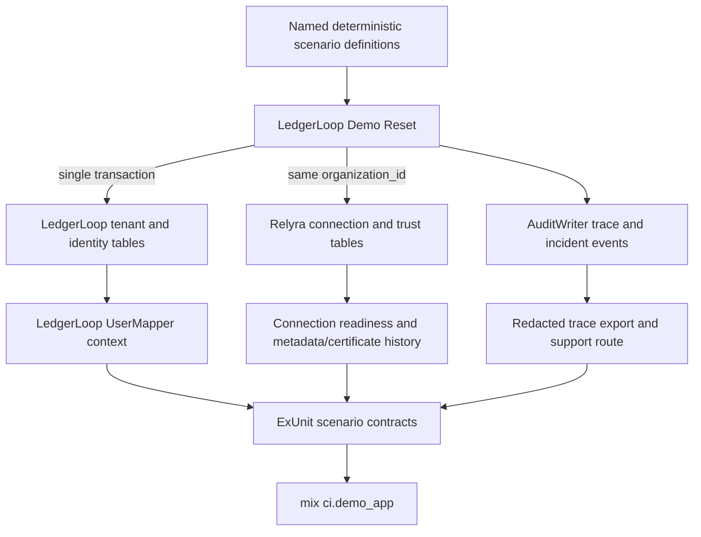

# Phase 75: SaaS Twin Domain Realism - Research

**Researched:** 2026-09-25
**Domain:** Elixir/Phoenix adopter fixtures, multi-tenant identity, trust history, and deterministic support evidence
**Confidence:** HIGH

<user_constraints>
## User Constraints (from CONTEXT.md)

### Locked Decisions
- **D-01:** Expand LedgerLoop's existing fixture and reset system as the canonical source for named Phase 75 scenarios. Keep reset and scenario data coherent rather than splitting fixture ownership.
- **D-02:** Represent each organization with tenant-linked people, groups, memberships, and SAML identities, and associate its Relyra connections through the tenant's organization identifier. Preserve a clear mapping from verified identity to tenant and authorization outcome.
- **D-03:** Present trust history as a chronological scenario that relates connection readiness, certificate lifecycle and validity, metadata revisions, and audit evidence. Represent degraded and recovered health accurately rather than treating them as certificate lifecycle values.
- **D-04:** Extend the existing support scenario with a symptom-to-recovery timeline connected to trace and audit evidence. Keep execution of the full recovery journey in Phase 76.

### the agent's Discretion
- Choose the exact scenario names, fixture records, and presentation that make the approved multi-tenant story understandable.
- Keep all fixture and incident evidence deterministic, isolated, redaction-safe, and tied to named scenarios.
- Do not introduce public API, protocol, default, or security-posture changes, or a human verification gate.

### Deferred Ideas (OUT OF SCOPE)
- Full login, rejection, tenant-isolation, diagnosis, and recovery journeys — Phase 76.
- No pending todos matched Phase 75.
</user_constraints>

<phase_requirements>
## Phase Requirements

| ID | Description | Research Support |
|----|-------------|------------------|
| TWIN-01 | LedgerLoop represents multiple organizations with distinct users, administrators, roles, groups, and authorization outcomes. | Extend the existing tenant, user, group, membership, and SAML identity fixtures; link each connection by tenant slug/organization identifier; contract-test mapped tenant, group/role, and named authorization outcomes. |
| TWIN-02 | LedgerLoop represents multiple credible IdP/provider and connection states without conflating tenant data. | Add named provider/connection scenarios in the central fixtures and assert each connection's `organization_id` belongs to its owning tenant and its provider/identity facts are scenario-specific. |
| TWIN-03 | LedgerLoop contains coherent metadata and certificate history covering draft, active, staged, expiring, retired, degraded, and recovered states. | Seed metadata revisions and certificate lifecycle/validity timestamps along one fixed-time ordered timeline; represent degraded/recovered as operational health and audit evidence, not certificate lifecycle. |
| TWIN-04 | LedgerLoop presents a complete synthetic incident timeline from symptom through diagnosis, remediation, retry, and recovery. | Extend the support scenario with linked, fixed-time redacted audit/trace events and assert the ordered timeline and correlation evidence. |
| TWIN-05 | Twin fixtures are deterministic, resettable, comprehensible, isolated, and safe for logs, screenshots, and CI artifacts. | Keep scenario definitions and reset behavior together; add repeated-reset equality, tenant isolation, named-row ownership, redaction, and stable chronological ordering contracts under `ci.demo_app`. |
</phase_requirements>

## Project Constraints (from AGENTS.md)

- Before writing code, read the active phase plan and `.planning/STATE.md`; do not implement outside active plan scope. If no active plan exists, do not start building.
- Escalate before public API shape changes, default-tightening, security-posture changes, or real SemVer major bumps.
- Preserve configured-IdP-certificate-only trust; never trust document `KeyInfo`.
- Keep one XML parse path through Saxy; keep DTD/entity disabling and size guards on raw bytes before parsing.
- Require digest recomputation and genuine `:public_key.verify` signature verification.
- Co-commit trust mutation and audit row in the same Ecto transaction.
- Preserve production replay protection; ETS warns in production and Ecto is the cluster-safe default.
- Route runtime work through the existing crypto, XML, C14N, algorithm-policy, audit-writer, and behaviour seams; do not bypass them.
- Keep `mix test --warnings-as-errors`, `mix ci.security`, and `mix format --check-formatted` green; security suites remain separate `cmd mix test` processes.
- Never weaken `test/security/xml/adversarial_crypto_test.exs`; add corpus rows for new security-relevant code.
- New acceptance criteria require deterministic automated evidence in a mandatory CI lane. Do not introduce blocking manual verification, `human_needed`, manual-only validation, or required UAT artifacts for incomplete phases.
- Use isolated fixtures or owned browser/container harnesses for host/browser/Docker/external-service state; unresolved automation is an explicit gap, not a manual approval.
- Use conventional commits; do not hand-edit `CHANGELOG.md` or run `mix hex.publish` manually.

## Summary

Extend `LedgerLoop.Demo.Fixtures` and `LedgerLoop.Demo.Reset` as the single scenario source, using stable IDs and an explicit fixed-time event sequence. The current adopter already has tenant-owned users/groups/memberships/SAML identities and Relyra connection, certificate, metadata-revision, audit, and trace models, so this phase should be fixture/schema/test work in the host demo. No new package is needed. [VERIFIED: `.planning/phases/75-saas-twin-domain-realism/75-CONTEXT.md:77-94`; `demo/ledger_loop/lib/ledger_loop/demo/fixtures.ex:1-47`; `demo/ledger_loop/lib/ledger_loop/demo/reset.ex:13-45`]

The key modeling rule is to keep separate concerns separate: tenant ownership belongs to LedgerLoop; Relyra connections identify the tenant with `organization_id`; connection readiness is distinct from certificate lifecycle; certificate expiry comes from validity dates; degraded/recovered is operational health; and the incident is an ordered trace/audit narrative. The current seed only covers Northstar, four connection rows, three certificate rows, and six login trace steps; it has no coherent metadata-revision history and the current support trace ends in a failed session step without diagnosis/remediation/retry/recovery evidence. [VERIFIED: `demo/ledger_loop/lib/ledger_loop/demo/fixtures.ex:49-155`; `demo/ledger_loop/lib/ledger_loop/demo/reset.ex:46-85`; `lib/relyra/ecto/certificate.ex:17-37`; `lib/relyra/ecto/metadata_revision.ex:24-47`]

**Primary recommendation:** Create a small number of named scenarios across at least two tenants, centrally define tenant-linked identities/groups/connections and a single fixed chronology for trust and support evidence, reset all rows in one transaction, and add deterministic ExUnit contracts to the existing `ci.demo_app` lane. Keep Phase 76's live login/rejection/isolation/recovery execution out of this phase.

## Architectural Responsibility Map

| Capability | Primary Tier | Secondary Tier | Rationale |
|------------|-------------|----------------|-----------|
| Tenant, user, group, membership, and identity facts | Database / Storage | API / Backend | LedgerLoop owns adopter identity and tenant linkage in its Ecto schemas; its mapper returns verified-principal context. |
| Connection/provider configuration and trust history | Database / Storage | API / Backend | Relyra Ecto rows hold connections, certificates, metadata revisions, and audit events; LedgerLoop owns named seed scenarios. |
| Deterministic scenario reset and seed entry | API / Backend | Database / Storage | Reset orchestration owns deletion/recreation ordering and wraps the fixture rebuild in a repository transaction. |
| Support timeline presentation | Frontend Server (SSR) | Database / Storage | The host support affordance routes to the Relyra connection trace surface; trace export applies redaction and correlation hashing. |
| Acceptance evidence | API / Backend | — | ExUnit scenario contracts run through `ci.demo_app` and its PostgreSQL-backed host suite. |

## Standard Stack

### Core

| Library | Version | Purpose | Why Standard |
|---------|---------|---------|--------------|
| Elixir | Existing project target: `~> 1.15` in LedgerLoop; CI uses `1.19.5` | Fixture/reset/test implementation | Already used by the adopter and current demo-app CI matrix. [VERIFIED: `demo/ledger_loop/mix.exs:4-15`; `.github/workflows/demo-app-ci.yml:38-43`; quote: `elixir: "~> 1.15"`, `elixir: ["1.19.5"]`] |
| Ecto + Ecto SQL | Locked versions `3.13.5` / `3.13.5` | Tenant/trust fixture persistence and database tests | Existing schemas and PostgreSQL test infrastructure; SQL Sandbox provides test transaction isolation. [VERIFIED: `mix.lock:9-10`; quote: `"ecto": {:hex, :ecto, "3.13.5"`, `"ecto_sql": {:hex, :ecto_sql, "3.13.5"`; [Ecto SQL Sandbox docs](https://ecto-sql.hexdocs.pm/Ecto.Adapters.SQL.Sandbox.html)] |
| Postgrex | Locked version `0.22.2` | PostgreSQL adapter | Existing LedgerLoop test config uses PostgreSQL. [VERIFIED: `mix.lock:37`; quote: `"postgrex": {:hex, :postgrex, "0.22.2"`; `demo/ledger_loop/config/test.exs:8-14`] |
| ExUnit | Bundled with Elixir | Deterministic scenario and reset contracts | Current LedgerLoop tests use `LedgerLoop.DataCase` with SQL Sandbox and `ci.demo_app` invokes the complete demo suite. [VERIFIED: `demo/ledger_loop/test/support/data_case.ex:1-40`; `mix.exs:288-292`] |

### Supporting

| Library | Version | Purpose | When to Use |
|---------|---------|---------|-------------|
| `Relyra.Ecto.*` schemas and `AuditWriter` | In-repository | Connection, certificate, metadata revision, and audit facts | Use the existing library tables and audit seam for trust-history fixture rows. [VERIFIED: `demo/ledger_loop/lib/ledger_loop/demo/reset.ex:9-10,40-80`] |
| `Relyra.LoginTrace.Export` | In-repository | Safe support trace summaries | Use for exported screenshots/log evidence; preserve hashed correlation IDs and allowed step fields. [VERIFIED: `lib/relyra/login_trace/export.ex:1-28,48-72`] |

### Alternatives Considered

| Instead of | Could Use | Tradeoff |
|------------|-----------|----------|
| Existing `Fixtures` + `Reset` ownership | Split files/seed scripts per scenario | Splitting fixture/reset ownership risks partial reset and scenario drift, contradicting D-01. |
| Existing Relyra trust/audit schemas | New demo-only trust state machine | A parallel model duplicates real adopter structures and risks presenting invented lifecycle values as library behavior. |
| Deterministic fake provider scenarios | Require a live external IdP in merge CI | A live provider adds nondeterminism and belongs in scheduled canary evidence; deterministic local rows should own Phase 75 acceptance. |

**Installation:** None. This phase should not add external packages; use the dependencies already declared by LedgerLoop.

## Architecture Patterns

### System Architecture Diagram



### Recommended Project Structure

```text
demo/ledger_loop/lib/ledger_loop/demo/
├── fixtures.ex       # Named tenant/provider/trust/incident fixture data
└── reset.ex          # Transactional deterministic recreation
demo/ledger_loop/test/twin/
├── organization_test.exs
├── provider_test.exs
├── certificate_history_test.exs
├── incident_timeline_test.exs
└── reset_test.exs
```

The five test paths are already declared as the deterministic requirement owners in `test/support/adoption_evidence.ex`; keep those owners and the `ci.demo_app` lane aligned. [VERIFIED: `test/support/adoption_evidence.ex:159-168`; quote: `"demo/ledger_loop/test/twin/organization_test.exs"`, `"demo/ledger_loop/test/twin/provider_test.exs"`, `"demo/ledger_loop/test/twin/certificate_history_test.exs"`, `"demo/ledger_loop/test/twin/incident_timeline_test.exs"`, `"demo/ledger_loop/test/twin/reset_test.exs"`; `mix.exs:288-292`]

### Pattern 1: One Scenario Catalog, One Transactional Reset

**What:** Keep named fixture data in `Fixtures`; reset tenant-owned and Relyra-owned rows together through `Reset.reset!/0` inside `Repo.transaction/1`. Delete existing audit/certificate/mapping rows before deleting connection rows, then insert prerequisite tenant and user data before dependent rows. [VERIFIED: `demo/ledger_loop/lib/ledger_loop/demo/reset.ex:16-45`]

**When to use:** Every persistent row in the demo should be attributable to a named scenario and reproducible by `mix ecto.setup`/the reset entry point.

**Example:**

```elixir
Repo.transaction(fn ->
  Repo.delete_all(from tenant in Tenant, where: tenant.id == ^scenario.tenant_id)
  Repo.insert_all(Tenant, scenario.tenants)
  Repo.insert_all(User, scenario.users)
  Repo.insert_all(Connection, scenario.connections)
  Repo.insert_all(Certificate, scenario.certificates)
end)
```

This is a structural sketch of the existing reset pattern; it intentionally leaves fixture-specific fields to the scenario catalog. [VERIFIED: `demo/ledger_loop/lib/ledger_loop/demo/reset.ex:16-45`]

### Pattern 2: Model Trust History Along Existing Seams

**What:** Use `MetadataRevision` rows for ordered source/outcome/trust snapshots; use `Certificate` rows for validity dates and certificate lifecycle; use the connection's active/last-known-good revision references and audit events to connect events. Keep fixture timestamps in the past relative to the fixed scenario clock and assert explicit event ordering rather than relying on insertion order alone. [VERIFIED: `lib/relyra/ecto/metadata_revision.ex:24-47`; `lib/relyra/ecto/certificate.ex:17-37`; `lib/relyra/ecto/connection.ex:28-55`]

**In-repo values (verbatim):** Provider presets are `@provider_presets [:okta, :entra, :google_workspace, :adfs]`; connection status is `field :status, Ecto.Enum, values: [:draft, :enabled, :disabled], default: :draft`; certificate lifecycle is `@lifecycle_states [:active, :next, :retired]`; metadata revision outcomes are `:applied`, `:registered`, `:fetch_failed`, `:parse_failed`, `:validation_failed`, and `:apply_failed`. [VERIFIED: `lib/relyra/ecto/connection.ex:21,33`; `lib/relyra/ecto/certificate.ex:11-12`; `lib/relyra/ecto/metadata_revision.ex:15-22`]

**When to use:** TWIN-03. Represent “draft” with a draft connection, “staged” with the next certificate and staged timestamp, “expiring” with a fixed `not_after` near the scenario's explicit as-of date, and “retired” with a retired certificate/timestamp. Represent degraded/recovered health through metadata-source health facts and ordered audit events; do not add those labels to the certificate enum. [VERIFIED: `lib/relyra/ecto/certificate.ex:23-27`; `lib/relyra/ecto/metadata_source.ex:42-56`; quote: `field :last_validity_warning_for, :utc_datetime_usec`, `field :auto_suspended_until, :utc_datetime_usec`, `field :auto_suspended_reason, Ecto.Enum, values: @suspended_reason_values`]

### Pattern 3: Tenant Linkage and Authorization Outcome Are Host-Owned

**What:** Give every scenario tenant a stable ID/slug, users and groups with the same tenant ID, membership rows connecting only same-tenant users/groups, SAML identities keyed by issuer/subject, and connections whose `organization_id` equals the owning tenant slug. Exercise mapper output for a verified-principal-shaped input and make the seeded group/role and expected allow/deny outcome explicit in the scenario evidence. [VERIFIED: `demo/ledger_loop/lib/ledger_loop/accounts/user.ex:8-20`; `demo/ledger_loop/lib/ledger_loop/accounts/group.ex:8-20`; `demo/ledger_loop/lib/ledger_loop/accounts/membership.ex:8-20`; `demo/ledger_loop/lib/ledger_loop/accounts/saml_identity.ex:8-22`; `demo/ledger_loop/lib/ledger_loop/relyra/user_mapper.ex:13-56`]

**In-repo values (verbatim):** The present user mapper returns `id`, `email`, `name`, a `tenant` map with `id`, `name`, `slug`, and `groups`; its query matches `identity.subject == ^subject and identity.issuer == ^issuer`. [VERIFIED: `demo/ledger_loop/lib/ledger_loop/relyra/user_mapper.ex:17-23,45-56`]

**When to use:** TWIN-01 and TWIN-02. The current `LoginReceipt` has `scenario_key` and `user_id` only, so do not claim that the existing receipt persists roles or authorization outcomes; use the smallest host-owned fixture/assertion extension needed to name those outcomes. [VERIFIED: `demo/ledger_loop/lib/ledger_loop/accounts/login_receipt.ex:8-20`]

### Pattern 4: Synthetic Incident Events Stay Redacted and Correlated

**What:** Extend the existing support connection's event story so symptom, diagnosis, remediation, retry, and recovery each have a stable event order, actor/cause, safe bounded summaries, and one correlation lineage. Test both stored summaries and `Relyra.LoginTrace.Export` output. `AuditEvent` constrains summary sizes, while `Export` drops actor, hashes correlation IDs, scrubs sensitive keys/binaries, and exposes an allow-listed step set. [VERIFIED: `lib/relyra/ecto/audit_event.ex:13-48,85-115`; `lib/relyra/login_trace/export.ex:15-45,48-72`]

**When to use:** TWIN-04/05. Seed only synthetic identifiers and safe error summaries; do not seed raw assertions, metadata XML, PEM, private keys, credentials, cookies, or real user data.

### Anti-Patterns to Avoid

- **Treating `:next`/`:retired` as operational health:** Certificate lifecycle does not express degraded/recovered health. Keep the dimensions distinct.
- **Reusing Northstar values across organizations:** Similar connection copies with only a changed display name do not establish tenant/provider separation; vary issuer, provider, identity, group, and outcome meaningfully.
- **Leaving timestamps to wall clock:** `insert_all` preserves supplied deterministic timestamps, but changeset helpers can fill lifecycle timestamps with `DateTime.utc_now/0`; seed explicit timestamps when using changesets. [VERIFIED: `demo/ledger_loop/lib/ledger_loop/demo/fixtures.ex:46-47`; `lib/relyra/ecto/certificate.ex:99-104`]
- **Making reset global:** Deleting all connections/audits would collide with local optional Keycloak setup; reset scoped rows by owned tenant/organization/scenario identities and preserve unrelated data. Existing reset currently scopes Relyra deletion by `organization_id == "northstar"`. [VERIFIED: `demo/ledger_loop/lib/ledger_loop/demo/reset.ex:18-30`; quote: `where: c.organization_id == "northstar"`]
- **Calling seed data evidence for real journeys:** This phase sets up comprehensible records and deterministic contracts. It does not execute the full login/isolation/diagnosis/recovery flows reserved for Phase 76.

## Don't Hand-Roll

| Problem | Don't Build | Use Instead | Why |
|---------|-------------|-------------|-----|
| Certificate, metadata, connection, and audit persistence | Demo-specific shadow schemas or free-form lifecycle enum | Existing `Relyra.Ecto.Connection`, `Certificate`, `MetadataRevision`, `MetadataSource`, and `AuditEvent` | Those tables already encode the actual adopter/library boundary. |
| Trust mutation audit rows | Direct bypass that calls `Repo.insert` to mimic a mutation audit | Existing `Relyra.Ecto.AuditWriter` for mutation paths; fixture reset may insert clearly synthetic rows only where it is seeding history | Trust mutation audit has an established transactional write seam. [VERIFIED: `AGENTS.md:32-36`; `demo/ledger_loop/lib/ledger_loop/demo/reset.ex:9-10,79`] |
| Trace display/export redaction | Demo-local correlation hashing or ad hoc PEM/XML filtering | `Relyra.LoginTrace.Export` | It is the shared redaction/export seam for UI and CLI and has tests. |
| Database test cleanup/isolation | Hand-written table cleanup after each test | `LedgerLoop.DataCase` + SQL Sandbox | Sandbox transaction ownership is already the LedgerLoop convention; SQL Sandbox docs describe transactional test isolation. [CITED: [Ecto SQL Sandbox](https://ecto-sql.hexdocs.pm/Ecto.Adapters.SQL.Sandbox.html)] |

**Key insight:** The phase is about the truthfulness and connectedness of existing adopter facts. The schemas, fixture owner, reset transaction, audit writer, and trace exporter already cover the hard persistence and safety parts; duplicating them would create competing sources of truth.

## Common Pitfalls

### Pitfall 1: Cross-Tenant Group Memberships Hide in Valid Foreign Keys

**What goes wrong:** A membership can reference a user and group that each exist but belong to different tenants; current schema foreign keys independently reference users and groups, while `Membership.changeset/2` only validates both IDs. [VERIFIED: `demo/ledger_loop/priv/repo/migrations/20260612170000_create_ledger_loop_demo_tables.exs:41-53`; `demo/ledger_loop/lib/ledger_loop/accounts/membership.ex:15-20`]

**Why it happens:** Tenant equality is a semantic invariant spanning two associations, not a currently modeled composite foreign key.

**How to avoid:** Make the fixture catalog tenant-consistent and add an explicit contract that joins memberships to both user and group and compares tenant IDs. Avoid turning that into Phase 76's full runtime isolation journey.

**Warning signs:** A mapped user returns a group whose `tenant_id` differs from the user's tenant, or a connection's `organization_id` does not match the identity's owning tenant.

### Pitfall 2: Chronology Appears Stable but Is Not

**What goes wrong:** Audit rows share identical timestamps or insertion order changes, so a timeline sorts ambiguously or tells a recovery story in the wrong order.

**Why it happens:** Existing fixture rows use one fixed timestamp; trust/certificate changesets can also generate current timestamps when fields are omitted.

**How to avoid:** Define one fixed as-of timestamp and deterministic, distinct event timestamps/sequence fields for the story. Add a contract for the ordered tuple, not only row presence.

**Warning signs:** Tests use `Repo.all/1` natural return order, use the current clock, or compare only counts.

### Pitfall 3: Metadata and Certificate State Collapse Together

**What goes wrong:** Tests label a connection “recovered” solely because a certificate is active, even while its metadata source remains failed/suspended or the connection is disabled.

**Why it happens:** Certificate lifecycle is easy to query, but health fields live on `MetadataSource`, while metadata revisions capture revision outcomes and audit history.

**How to avoid:** Assert a coherent snapshot across connection status, active and last-known-good revision references, certificate validity/lifecycle, metadata-source health, and corresponding audit events. Do not mutate Relyra production state machine behavior to make the fixture easier.

**Warning signs:** “degraded” or “recovered” appears as a certificate `lifecycle_state`, or a recovery row has no preceding symptom and remediation event.

### Pitfall 4: Reset Deletes State Owned by Another Scenario

**What goes wrong:** Resetting the deterministic fixture removes optional Keycloak rows or other local demo data.

**Why it happens:** A scope change from current Northstar-only deletion to broad `Repo.delete_all/1` is tempting when adding multiple tenants.

**How to avoid:** Keep a closed list of fixture-owned tenant slugs/IDs and connection IDs, delete dependent audit/trust rows only for those owned IDs, and add a sentinel row outside the fixture that survives reset. [VERIFIED: `demo/ledger_loop/lib/ledger_loop/demo/keycloak_provisioner.ex:134-145`; `demo/ledger_loop/lib/ledger_loop/demo/reset.ex:18-30`]

**Warning signs:** Reset deletes every `Connection` row or removes a Keycloak connection with a different scenario owner.

### Pitfall 5: Safe in Storage, Unsafe in Rendered Evidence

**What goes wrong:** A summary omits XML but leaks a correlation token, PEM, private material, or sensitive nested step field through screenshots/CI logs.

**Why it happens:** Stored summaries and exported/rendered summaries are different paths; redaction is recursive and allow-list based in the shared exporter.

**How to avoid:** Test stored synthetic summaries, `Export.export_login/1`, and the support route/rendered output; assert correlation hashing and absence of forbidden payload markers.

**Warning signs:** UI reads raw `AuditEvent` maps or tests only inspect a hand-picked top-level field.

## Code Examples

Verified patterns from the current project:

### Run a deterministic transactional reset

```elixir
Repo.transaction(fn ->
  # Delete only owned fixture data and its dependent trust/audit rows.
  # Reinsert tenants before tenant-owned and connection-owned rows.
end)
```

This preserves the established `Reset.reset!/0` transaction boundary. [VERIFIED: `demo/ledger_loop/lib/ledger_loop/demo/reset.ex:16-45`]

### Exercise reset determinism under the test sandbox

```elixir
use LedgerLoop.DataCase, async: false

setup do
  Reset.reset!()
  :ok
end

test "repeat reset keeps fixture rows identical" do
  Reset.reset!()
  first = Repo.all(Tenant)
  Reset.reset!()
  assert Repo.all(Tenant) == first
end
```

The existing reset contract uses a SQL Sandbox owner and compares rows after repeated reset calls; use a full scenario snapshot rather than tenant rows alone. [VERIFIED: `demo/ledger_loop/test/support/data_case.ex:30-40`; `demo/ledger_loop/test/ledger_loop/demo/reset_test.exs:73-102`]

### Keep IDs and timestamps stable

```elixir
@fixed_timestamp ~U[2026-06-12 12:00:00.000000Z]

def scenario do
  %{tenant: %{id: @stable_tenant_id}, inserted_at: @fixed_timestamp}
end
```

The example pattern is present in the fixture module; ensure each proposed ID/date is explicitly owned and keep any in-repo discrete values literal only when copied from its source. [VERIFIED: `demo/ledger_loop/lib/ledger_loop/demo/fixtures.ex:16-47`]

## Validation Architecture

### Test Framework

| Property | Value |
|----------|-------|
| Framework | ExUnit (bundled with Elixir); LedgerLoop uses Ecto SQL Sandbox |
| Config file | `demo/ledger_loop/config/test.exs`; `demo/ledger_loop/test/support/data_case.ex` |
| Quick run command | `mix cmd --cd demo/ledger_loop mix test test/twin/reset_test.exs` |
| Full suite command | `mix ci.demo_app` |

The repository alias runs LedgerLoop `deps.get`, `ecto.setup`, and `mix test`; the blocking demo-app workflow invokes that alias. [VERIFIED: `mix.exs:288-292`; `.github/workflows/demo-app-ci.yml:62-63`]

### Phase Requirements → Test Map

| Req ID | Behavior | Test Type | Automated Command | File Exists? |
|--------|----------|-----------|-------------------|-------------|
| TWIN-01 | Distinct tenants, admins/end users, groups/roles, and named authorization outcomes | integration | `mix ci.demo_app` | ❌ Add `demo/ledger_loop/test/twin/organization_test.exs` |
| TWIN-02 | Provider and connection variation remains linked to the correct tenant | integration | `mix ci.demo_app` | ❌ Add `demo/ledger_loop/test/twin/provider_test.exs` |
| TWIN-03 | Ordered metadata/certificate validity and health history tells a coherent story | integration | `mix ci.demo_app` | ❌ Add `demo/ledger_loop/test/twin/certificate_history_test.exs` |
| TWIN-04 | Symptom-to-recovery events correlate across trace and audit evidence | integration | `mix ci.demo_app` | ❌ Add `demo/ledger_loop/test/twin/incident_timeline_test.exs` |
| TWIN-05 | Repeated reset is byte/row-equivalent, isolated, named, and redaction-safe | integration | `mix ci.demo_app` | ❌ Add `demo/ledger_loop/test/twin/reset_test.exs` |

The test-file ownership paths are listed by the existing adoption evidence ledger, but these files were absent in this checkout at research time. [VERIFIED: `test/support/adoption_evidence.ex:159-168`]

### Sampling Rate

- **Per task commit:** Run the focused test selector for the changed scenario file, then `mix ci.demo_app` before closing the acceptance-bearing task.
- **Per wave merge:** `mix ci.demo_app`.
- **Phase gate:** Full `mix ci.demo_app` green; repository CI must continue to run `mix test --warnings-as-errors`, `mix ci.security`, and `mix format --check-formatted` unchanged.

### Wave 0 Gaps

- [ ] Add the five ledger-declared `demo/ledger_loop/test/twin/*.exs` owners above. No separate test framework installation is needed.
- [ ] Extend fixture/reset tests to prove out-of-scenario sentinel data survives reset and every seeded row belongs to a declared scenario.

## Security Domain

### Applicable ASVS Categories

| ASVS Category | Applies | Standard Control |
|---------------|---------|-----------------|
| V2 Authentication | yes, fixture realism only | Seed identity facts; do not alter authentication/protocol behavior in this phase. |
| V3 Session Management | no new behavior | Leave session journey to Phase 76; preserve current session seam. |
| V4 Access Control | yes | Keep tenant group membership and role/outcome fixtures tenant-consistent; add deterministic negative authorization outcome evidence. |
| V5 Input Validation | yes, data contracts | Use existing Ecto changesets and closed in-repo enums; do not invent new free-form connection/certificate states. |
| V6 Cryptography | no new behavior | Use existing certificate fixture material where needed; never treat dummy PEM as valid real-provider evidence or change crypto seams. |

### Known Threat Patterns for LedgerLoop fixtures

| Pattern | STRIDE | Standard Mitigation |
|---------|--------|---------------------|
| Membership connects a user's tenant to another tenant's group | Elevation of privilege | Fixture contract joins membership to both sides and asserts tenant ID equality. |
| Connection provider/issuer history assigned to the wrong tenant | Spoofing / Elevation of privilege | Assert `organization_id` ownership and identity issuer/subject alignment per named scenario. |
| Synthetic incident summary contains XML, PEM, credentials, or unredacted correlation data | Information disclosure | Use `AuditWriter`, bounded summaries, `Relyra.LoginTrace.Export`, and redaction assertions. |
| Reset deletes non-fixture tenant/provider state | Denial of service / Tampering | Restrict deletion to fixture-owned identifiers; include a surviving sentinel scenario in reset tests. |

No new crypto, parser, protocol, public API, or authorization behavior is recommended by this research. Preserve the project invariants and keep acceptance evidence deterministic.

## Environment Availability

| Dependency | Required By | Available | Version | Fallback |
|------------|------------|-----------|---------|----------|
| PostgreSQL | LedgerLoop migrations and Ecto tests | ✓ | Local `pg_isready` reports accepting connections | CI provisions `postgres:16` |
| Docker | Optional local adopter services, not fixture tests | ✓ | `29.5.2` | No Docker needed for `mix ci.demo_app` tests when PostgreSQL is available |
| Elixir/Mix | LedgerLoop compile/test | ⚠️ | Elixir 1.20.2 / OTP 29 is selected by local shim; repository CI tuple is Elixir 1.19.5 on OTP 27/28 | Use configured CI versions or an explicit asdf version; current repo-local `.tool-versions` selects Node only |

The local PostgreSQL service is reachable, but `mix --version` could not select a version because the current `.tool-versions` omits Elixir. `.planning/STATE.md` records that this file is user-owned and directs explicit Elixir/Erlang selection for local validation. Do not edit it as part of Phase 75.

## Sources

### Primary (HIGH confidence)

- `.planning/phases/75-saas-twin-domain-realism/75-CONTEXT.md` — Locked scope, reuse decisions, and exact boundary with Phase 76.
- `.planning/REQUIREMENTS.md` and `.planning/ROADMAP.md` — TWIN-01..TWIN-05 acceptance boundaries and Phase 75 success criteria.
- `.planning/STATE.md` and `AGENTS.md` — Milestone decisions, immutable security guardrails, and mandatory automated evidence policy.
- `demo/ledger_loop/lib/ledger_loop/demo/fixtures.ex`, `reset.ex`, account schemas, and tests — Current fixture/reset patterns and explicit baseline gaps.
- `lib/relyra/ecto/{connection,certificate,metadata_revision,metadata_source,audit_event}.ex` and `lib/relyra/login_trace/export.ex` — Existing modeled trust dimensions, health state, bounded audit summaries, and redaction seam.
- `test/support/adoption_evidence.ex`, `mix.exs`, `.github/workflows/demo-app-ci.yml` — Exact Phase 75 test owners and current deterministic CI lane.

### Secondary (MEDIUM confidence)

- [Ecto SQL Sandbox official documentation](https://ecto-sql.hexdocs.pm/Ecto.Adapters.SQL.Sandbox.html) — Database-backed test transaction isolation guidance; current version docs accessed 2026-09-25.

## Assumptions Log

| # | Claim | Section | Risk if Wrong |
|---|-------|---------|---------------|
| A1 | Existing `ci.demo_app` is the intended deterministic owner for the Phase 75 test contracts. | Validation Architecture | CI could fail to enforce TWIN requirements if workflow ownership changes; the Phase 73 evidence ledger currently declares this lane. |
| A2 | Fixture history can be seeded as fixed synthetic records without exercising Relyra mutation operations; full mutation journey remains Phase 76. | Architecture Patterns | If Phase 75 instead requires actual state-machine execution, plans must include the necessary safe mutation/audit proof without widening into full journeys. |

## Open Questions (RESOLVED)

1. **Which two organizations and named personas best tell the approved scenario story? (RESOLVED)**
   - What we know: Exact records and names are delegated to agent discretion; retain Northstar as the anchor.
   - Resolution: Keep Northstar Health (`northstar`) with Dr. Sarah as administrator and Nurse Chen as clinical end user. Add Harborline Logistics (`harborline`) with Maya Patel as administrator and Luis Ortega as operations end user, using a distinct Google Workspace provider preset, issuer and subjects. Their mapped groups carry the named tenant-admin allow/deny expectations in the organization contract (D-01, D-02).
2. **How should the authorization outcome be persisted for inspection? (RESOLVED)**
   - What we know: Current mapper returns tenant/groups; `LoginReceipt` stores only user and scenario key.
   - Resolution: Persist tenant, identity and group membership in existing host tables; declare each persona's expected tenant-admin allow/deny outcome in the named `organization_test.exs` contract and assert it against the mapped groups. Phase 75 adds no host schema field or runtime authorization subsystem; Phase 76 owns execution of authorization journeys (D-02).

## Metadata

**Confidence breakdown:**
- Standard stack: HIGH — verified against current LedgerLoop `mix.exs`, test config, and CI.
- Architecture: HIGH — primary evidence is the current repo schemas, fixture/reset path, and locked phase context.
- Pitfalls: HIGH — grounded in current constraints and observed schema/reset/redaction seams.

**Research date:** 2026-09-25
**Valid until:** 2026-10-25 (stable in-repository architecture; revisit if Phase 76 changes ownership)
