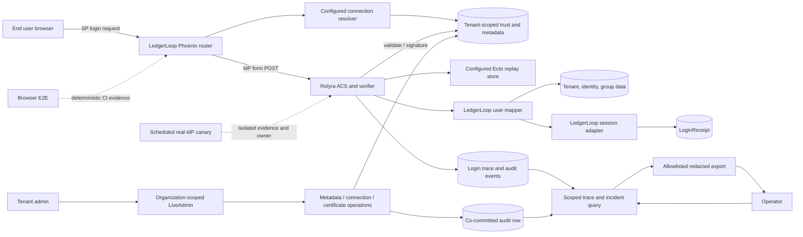

<user_constraints>
## User Constraints (from CONTEXT.md)

### Locked Decisions
## Implementation Decisions

### Twin and Login Boundary
- **D-01:** Exercise lifecycle journeys in LedgerLoop through its real Phoenix routes and configured behavior adapters. Keep Phase 74's clean-room consumer as a bounded package-boundary success proof.

### Rejection and Tenant-Isolation Evidence
- **D-02:** Assert representative invalid responses produce stable typed rejections and no adopter-owned session. Verify tenant isolation through the existing seeded organizations and the configured resolver, mapper, replay, session, trace, audit, and authorization outcomes.
- **D-03:** Check session establishment and role together at the scenario outcome level, while covering any other host-owned session side effects that participate in the real flow.

### Admin Trust Lifecycle and Audit
- **D-04:** Run metadata review, connection enablement, staged rollover, and recovery through LedgerLoop's existing organization-scoped admin integration and Relyra trust-mutation seams. Preserve transactionally co-committed, redaction-safe audit evidence for every mutation.
- **D-05:** Exercise the audited domain operations and admin scope in deterministic automation; use UI flows where they are already part of the supported journey and necessary to prove the acceptance boundary.

### Diagnosis, Recovery, and Canary Ownership
- **D-06:** Use the seeded support incident with real correlated trace and audit evidence as the operator diagnosis and recovery source; verify the recovery outcome and redaction through the existing export path.
- **D-07:** Keep external-provider canaries separate from deterministic merge gates. Give browser and scheduled real-IdP canary failures explicit safe evidence, ownership, and recovery actions without creating human CI gates.

### the Agent's Discretion
- Select focused journey boundaries and assertions that cover all named success criteria without duplicating Phase 74's clean-room proof.
- Resolve exact test organization and browser/canary wiring within current mandatory CI ownership, preserving stable typed errors and all existing security invariants.

### Deferred Ideas (OUT OF SCOPE)
- `AUTHN-POST-01`, `KMS-01`, and `SIGNED-META-01` remain demand-gated future capabilities.
- No todos matched Phase 76 for folding into scope.
</user_constraints>

<phase_requirements>
## Phase Requirements

| ID | Description | Research Support |
|----|-------------|------------------|
| EVID-03 | External-provider canaries are clearly separated from deterministic merge gates and retain safe failure evidence. | Dedicated scheduled job and safe evidence ownership; keep the containerized Keycloak adoption lane distinct from an externally managed provider canary. |
| JOUR-01 | An end user can complete SP-initiated login and receive the correctly mapped adopter-owned session and authorization outcome. | Reuse LedgerLoop endpoint round-trip, mapper, session adapter and tenant/role outcome tests; strengthen outcome assertions. |
| JOUR-02 | Invalid digest, signature, issuer, audience, destination, time, and request-correlation inputs produce typed rejections and no session. | Parameterized real-ACS cases plus receipt/session side-effect checks and existing typed-error/security corpus. |
| JOUR-03 | Replaying an accepted assertion is rejected through the configured replay-store boundary. | Re-submit the accepted response through LedgerLoop ACS and assert configured Ecto replay boundary rejects without another receipt. |
| JOUR-04 | Multi-tenant connection resolution, mappings, sessions, traces, and audits remain isolated across organizations. | Extend existing Northstar/Harborline fixtures and mapper tests into paired end-to-end login/rejection outcomes across configured behavior seams. |
| JOUR-05 | A tenant administrator can progress through metadata import, connection enablement, staged certificate rollover, and recovery with co-committed audit evidence. | Existing organization-scoped LiveAdmin, Metadata, Connections, CertificateInventory and AuditWriter seams; success and failure rollback assertions. |
| JOUR-06 | An operator can diagnose and recover a failed login using correlated, redacted evidence without exposing assertions, certificates, credentials, or cookies. | Extend seeded support incident tests to exercise diagnosis/recovery and export redaction; use existing login trace and diagnostic export seams. |
</phase_requirements>

Requirement IDs and descriptions above reproduce the source wording verbatim. [VERIFIED: `.planning/REQUIREMENTS.md:13,34-39`]

# Phase 76: Lifecycle and Recovery Journeys — Research

**Researched:** 2026-09-25  
**Domain:** Phoenix adopter journeys, SAML trust lifecycle, tenant isolation, evidence automation  
**Confidence:** HIGH for repository patterns and gaps; MEDIUM for external framework guidance; LOW for unspecified live-canary ownership details

## Summary

Phase 76 should extend the existing LedgerLoop/Northstar adopter tests around the real endpoint, configured behaviors, seeded organizations and Relyra trust/admin seams. A verified happy-path round trip and a digest-tamper rejection already pass through Phoenix ConnTest; fixture, typed replay error, organization mapping, trust audit rollback, and safe trace export each have narrower proof. The phase should connect those proofs at scenario level, especially accepted assertion replay, the full invalid-input matrix, tenant-separated login state, and admin-driven recovery. [VERIFIED: `demo/ledger_loop/test/ledger_loop_web/fake_idp_flow_test.exs:60-125`; `demo/ledger_loop/test/ledger_loop/relyra/store_wrapper_test.exs:38-48`; `demo/ledger_loop/test/twin/organization_test.exs:15-54`; `demo/ledger_loop/test/twin/incident_timeline_test.exs:26-90`]

The best implementation unit is a small set of journey tests and narrowly scoped supporting test helpers in LedgerLoop, not a new framework or a second clean-room consumer. Keep each invalid assertion case tied to the same ACS route and configured adapters, and assert typed error plus all adopter-owned success side effects (at minimum no new LoginReceipt/session on rejection). The configured adapters are exactly `connection_resolver: Relyra.ConnectionResolver.Ecto`, `request_store: LedgerLoop.Relyra.RequestStore`, `replay_store: LedgerLoop.Relyra.ReplayStore`, `user_mapper: LedgerLoop.Relyra.UserMapper`, `session_adapter: LedgerLoop.Relyra.SessionAdapter`, and `repo: LedgerLoop.Repo`. For trust changes, drive the supported organization-scoped admin entry and assert the domain mutation and its audit row both persist or both roll back. For the incident, connect an actual failed-login trace to the seeded timeline, exercise recovery, and inspect only the existing redacted export surface. [VERIFIED: `demo/ledger_loop/config/config.exs:33-39`; `demo/ledger_loop/lib/ledger_loop_web/router.ex:63-78`; `lib/relyra/ecto/audit_writer.ex:29-48`]

**Primary recommendation:** Add the lifecycle proofs to the existing LedgerLoop app test suite and its blocking `demo-app-ci` owner; retain deterministic browser E2E under the existing browser workflow, and give any live real-IdP canary a separate scheduled job with explicit owner, allowlisted/redacted artifact, retention, and recovery instructions. Do not add runtime packages or alter the SAML trust boundary. [VERIFIED: `mix.exs:288-291`; `.github/workflows/demo-app-ci.yml:16-63`; `.github/workflows/demo-app-e2e.yml:75-83`]

## Project Constraints (from AGENTS.md)

- Read the active plan and current STATE before implementation, and keep implementation within that plan. Exact directives: “Read the active phase plan”; “Check current position”; “Do not implement anything outside the active PLAN.md scope without flagging it.” [VERIFIED: `AGENTS.md:13-22`]
- Preserve the six security invariants: configured IdP certificates only; one Saxy parse path; raw-binary DTD/entity and size guards before parsing; recomputed digest and cryptographic `:public_key.verify`; transactional trust-mutation/audit co-commit; production replay protection with Ecto as cluster-safe default. [VERIFIED: `AGENTS.md:38-47`]
- Preserve the named crypto, parser, C14N, algorithm-policy, audit-writer, and behavior seams. The exact behavior names are “ConnectionResolver, SessionAdapter, UserMapper, RequestStore, ReplayStore”. [VERIFIED: `AGENTS.md:49-58`]
- Keep `mix test --warnings-as-errors`, `mix ci.security`, and `mix format --check-formatted` green; do not weaken the adversarial crypto corpus. New security acceptance criteria need deterministic automated evidence in a mandatory CI lane; do not add manual-only validation or human completion gates. [VERIFIED: `AGENTS.md:60-70`]
- Do not manually publish Hex; use conventional commits if committing is part of the plan. [VERIFIED: `AGENTS.md:72-86`]

## Architectural Responsibility Map

| Capability | Primary Tier | Secondary Tier | Rationale |
|------------|-------------|----------------|-----------|
| SAML login, typed rejection and replay decision | API / Backend | Browser / Client | Phoenix endpoint invokes Relyra validation and configured resolver/request/replay behaviors; browser only initiates and posts the form. |
| Tenant identity, group mapping and adopter receipt | API / Backend | Database / Storage | LedgerLoop owns subject-to-tenant/group mapping and persists LoginReceipt after successful verification. |
| Tenant admin trust mutations and audit | API / Backend | Database / Storage | Admin scope selects organization; Relyra domain operations own trust writes and audit co-commit within repository transactions. |
| Operator trace/incident diagnosis and export | API / Backend | Browser / Client | Query/export layer enforces scope and redaction; LiveView presents the limited evidence. |
| Browser E2E and live-provider canary evidence | Browser / Client | CI / External service | Browser harness proves the supported browser boundary; a real-provider canary owns external service availability and produces separate diagnostics. |

## Standard Stack

### Core

| Library | Version | Purpose | Why Standard |
|---------|---------|---------|--------------|
| Elixir / OTP | Elixir `~> 1.15` app declaration; CI runs Elixir `1.19.5` on OTP `27`/`28` | LedgerLoop and Relyra runtime/test code | Existing repository runtime and CI matrix. |
| Phoenix | LedgerLoop lock: `1.8.8` | Real router/endpoint and LiveView admin flows | Existing host routes mount Relyra SAML and organization-scoped LiveAdmin. |
| Ecto / Ecto SQL | LedgerLoop lock: `3.14.0` | Tenant fixture, trust persistence, replay and audit transactions | Existing configured Repo and transaction-aware Relyra seams. |
| ExUnit + Phoenix.ConnTest / LiveViewTest | Existing app test stack | Deterministic endpoint, LiveView and database journeys | Already covers a full fake-IdP SP flow and trace behavior. |

The discrete versions above are quoted from the project’s declarations and lock files: `demo/ledger_loop/mix.exs:8` says `elixir: "~> 1.15"`; `.github/workflows/demo-app-ci.yml:40-42` says `otp: [27, 28]` and `elixir: ["1.19.5"]`; `demo/ledger_loop/mix.lock:7-8` says `"ecto": ... "3.14.0"` and `"ecto_sql": ... "3.14.0"`; `demo/ledger_loop/mix.lock:20` says `"phoenix": ... "1.8.8"`. [VERIFIED: cited paths and lines]

### Supporting

| Library | Version | Purpose | When to Use |
|---------|---------|---------|-------------|
| Playwright Test | lock: `1.60.0` | Browser login and trace UI exercise | Reuse existing `demo:fake-idp` and `demo:trace-visual` flows when browser behavior is acceptance-relevant. |
| PostgreSQL / Postgrex | CI service image: `postgres:16`; LedgerLoop lock has Postgrex `0.22.2` | Persist tenant, replay and audit state | Required for the configured Ecto adapters and deterministic app test lane. |
| FakeIdP signer / fixtures | In-repo, no external package | Signed and intentionally altered response generation | Use for local deterministic journeys; keep live IdP tests outside merge-gate proof. |

The source declarations quote `"@playwright/test": "^1.54.2"` and the lock quotes `"version": "1.60.0"` (`package.json:11-13`, `package-lock.json:12-20`); CI quotes `image: postgres:16` (`.github/workflows/demo-app-ci.yml:18-31`); the demo lock quotes `"postgrex": ... "0.22.2"` (`demo/ledger_loop/mix.lock:29`). [VERIFIED: cited paths and lines]

### Alternatives Considered

| Instead of | Could Use | Tradeoff |
|------------|-----------|----------|
| LedgerLoop endpoint journey tests | Direct behavior-module-only unit tests | Unit tests remain useful for edge cases, but cannot establish configured route, adapter, session, and host side-effect behavior required by D-01/D-02. |
| In-process Phoenix tests | Browser-only acceptance proof | Browser proof is useful for the existing UI boundary but is slower and less diagnostic for the full rejection matrix; use a focused browser journey only where presentation/browser semantics matter. |
| Test-controlled Keycloak integration | Scheduled live-provider canary | The first is reproducible and merge-gate suitable; the second detects external drift/outage and must have separate failure ownership and safe retained evidence. |

No external package install is recommended for this phase. Existing code and test dependencies are sufficient. [VERIFIED: `demo/ledger_loop/mix.exs:41-58`; `package.json:4-13`]

## Architecture Patterns

### System Architecture Diagram



### Recommended Project Structure

Keep new scenario tests beside the current app boundaries; avoid new source modules unless the test helper has reuse beyond one focused journey. [VERIFIED: `demo/ledger_loop/test/ledger_loop_web/fake_idp_flow_test.exs:1-18`; `demo/ledger_loop/test/twin/organization_test.exs:1-14`]

```text
demo/ledger_loop/test/
├── ledger_loop_web/       # Endpoint and LiveView journey outcomes
├── ledger_loop/demo/      # Named scenario, reset, and trust audit evidence
└── twin/                  # Cross-organization and incident outcome evidence
```

### Pattern 1: Real endpoint journey, one outcome assertion set

**What:** Start at the SP login route, use LedgerLoop’s FakeIdP for an accepted signed response, post that response through the same ACS endpoint, then assert both the mapped receipt/session and the tenant/group authorization result. For invalid responses, preserve the same endpoint and verify typed rejection plus no new adopter-owned state. Phoenix ConnTest’s official guidance prefers endpoint-level requests for router-dispatched behavior. [CITED: https://phoenix.hexdocs.pm/Phoenix.ConnTest.html]

**When to use:** JOUR-01 through JOUR-04 and any negative SAML case whose acceptance depends on the host route or adapter side effects.

**Example:**

```elixir
conn = post(build_conn(), acs_path, response_params)

assert conn.status == expected_status
assert receipt_count_after == receipt_count_before
assert typed_error == expected_typed_error
```

This is an assertion skeleton: obtain the route and response from the existing fixture/FakeIdP flow, and bind the expected error to an exact source-defined value when implementing each test. [CITED: https://phoenix.hexdocs.pm/Phoenix.ConnTest.html] [VERIFIED: `demo/ledger_loop/test/ledger_loop_web/fake_idp_flow_test.exs:60-125`]

### Pattern 2: Trust state and audit row are one outcome

**What:** Exercise the Relyra metadata, connection, and certificate operations through LedgerLoop’s configured repository and admin scope. On success, read back both trust state and audit event; inject a failure at an existing supported seam and prove neither partial trust changes nor orphan audit rows remain. Ecto documents rollback of transaction work on error; current Relyra metadata tests already assert the connection, certificate, and audit outcomes. [CITED: https://ecto.hexdocs.pm/Ecto.Repo.html; https://ecto.hexdocs.pm/Ecto.Multi.html] [VERIFIED: `test/relyra/ecto/metadata_apply_test.exs:19-79`; `test/relyra/ecto/connection_record_test.exs:72-85`]

**When to use:** Each trust mutation in JOUR-05, especially import/review, enablement, staged certificate promotion/retirement and recovery.

### Pattern 3: Evidence exported through the same scoped redaction seam

**What:** Seed or produce trace and audit rows with one correlation identifier, query them as the owning organization, and inspect the exported result rather than proving safety only from stored rows. Assert cross-organization reads do not disclose another tenant’s event. `Relyra.LoginTrace.Export` hashes correlation IDs and filters step fields through an allowlist; existing incident coverage checks correlation hashing and forbidden payload markers. [VERIFIED: `lib/relyra/login_trace/export.ex:34-49,70-103`; `demo/ledger_loop/test/twin/incident_timeline_test.exs:61-90`]

**When to use:** JOUR-04 and JOUR-06; also use after recovery to show current trust and subsequent login outcome.

### Pattern 4: Separate merge-gate browser proof from live-provider health

**What:** Put deterministic FakeIdP/browser journeys in the existing `pull_request`/`push` browser workflow. Put any external managed IdP check in a scheduled-only job or explicitly selected dispatch job, with no dependency edge into required deterministic jobs. Always retain only validated, redacted diagnostics and state a responsible owner and recovery path in the run summary. The scheduled `rulestead-main-canary` has `retention-days: 7`, an artifact-handling precedent, not proof that it is a real-IdP canary. [VERIFIED: `.github/workflows/demo-app-e2e.yml:3-14,75-83`; `.github/workflows/fleet-proxy-e2e.yml:57-88`]

**When to use:** EVID-03 and D-07. Treat controlled ephemeral Keycloak in the adoption workflow as deterministic integration; do not call it a live external-provider availability canary. [VERIFIED: `.github/workflows/adoption-external-idp.yml:16-44,62-92`]

### Anti-Patterns to Avoid

- **Calling a behavior directly and counting that as end-to-end login:** it misses endpoint pipeline, request correlation, configured adapter resolution, and response/session effects. Use the real LedgerLoop endpoint for acceptance journeys. [VERIFIED: `demo/ledger_loop/test/ledger_loop_web/fake_idp_flow_test.exs:60-125`]
- **Counting a duplicate replay-store unit test as replay acceptance:** current wrapper tests directly call the store; JOUR-03 must replay an accepted response through ACS and show no second receipt. [VERIFIED: `demo/ledger_loop/test/ledger_loop/relyra/store_wrapper_test.exs:38-48,74-84`]
- **Treating the setup checklist as persisted trust administration:** its “save metadata” handler only flips an in-memory display flag; use the actual `ConnectionMetadataLive` / `ConnectionsLive` operations when claiming admin lifecycle coverage. [VERIFIED: `demo/ledger_loop/lib/ledger_loop_web/live/setup_live.ex:32-44`; `lib/relyra/live_admin/connection_metadata_live.ex:40-66`; `lib/relyra/live_admin/connections_live.ex:76-112`]
- **Sending raw assertions, cookies, credentials, PEMs, or XML to job artifacts:** use the existing redaction/allowlist/export boundaries and test the resulting artifact structure before upload. [VERIFIED: `lib/relyra/login_trace/export.ex:15-41`; `scripts/test_keycloak_proxy_e2e.sh:43-109,151-225`]
- **Making a scheduled external IdP a PR gate or treating a nonzero outage as code regression:** keep the service-health signal and deterministic acceptance status independently visible. [VERIFIED: `.github/workflows/fleet-proxy-e2e.yml:57-88`]

## Don't Hand-Roll

| Problem | Don't Build | Use Instead | Why |
|---------|-------------|-------------|-----|
| SAML signing / cryptographic fixture handling | A second signer, XML parser, or custom signature acceptance path | Existing FakeIdP signer and Relyra verifier seams | Maintains the one-parse and configured-certificate security boundaries; phase is evidence work, not protocol implementation. |
| Replay uniqueness | Test-only in-memory “already seen” flag | Configured `LedgerLoop.Relyra.ReplayStore` backed by Relyra Ecto replay adapter | Proves the same configured durable boundary production-like flow uses. |
| Trust mutation plus audit | Independent writes from tests or bespoke audit rows | Relyra domain operations and `Relyra.Ecto.AuditWriter` | The invariant requires atomic mutation/audit state and shared redaction behavior. |
| Trace sanitization | Test-local field filtering or regex-only assertion | Existing `Relyra.LoginTrace.Export` / diagnostic export seam | The product’s redaction policy is centralized and already designed for testable output. |
| Tenant scope | A parallel test-only tenant resolver | Existing organization IDs, `AdminScope`, resolver, mapper, and scoped query boundary | Keeps tenancy ownership in LedgerLoop and exercises actual host/library integration. |

**Key insight:** These requirements are about the composition of already-present seams. Most risk comes from proving only isolated components or trusting a UI fixture instead of the configured runtime path.

## Common Pitfalls

### Pitfall 1: Happy-path assertions stop at “receipt exists”

**What goes wrong:** An authenticated receipt may exist for the wrong organization, mapped identity, role/group, or connection.  
**Why it happens:** Existing endpoint test asserts Sarah’s receipt count, while organization role outcomes are currently tested separately at mapper level.  
**How to avoid:** At the success scenario boundary, assert tenant, user, groups/role and receipt identity together; include another org case.  
**Warning signs:** Tests assert only redirect/status or `length(receipts) >= 1`. [VERIFIED: `demo/ledger_loop/test/ledger_loop_web/fake_idp_flow_test.exs:111-124`; `demo/ledger_loop/test/twin/organization_test.exs:15-45`]

### Pitfall 2: “No session” checks miss host-owned side effects

**What goes wrong:** A rejected ACS post may still create LoginReceipt or some other flow state.  
**Why it happens:** There are persistent receipts plus request/replay/trace records; trace/audit of a rejection is expected, but a successful host session is not.  
**How to avoid:** Compare relevant host-owned session/receipt state before and after each rejected post; assert diagnostic trace persists separately and is redacted. [VERIFIED: `demo/ledger_loop/lib/ledger_loop/relyra/session_adapter.ex:18-39`; `demo/ledger_loop/test/ledger_loop_web/fake_idp_flow_test.exs:172-210`]

### Pitfall 3: Replaying does not exercise the configured boundary

**What goes wrong:** Unit coverage says duplicate replay keys reject, but the login route can regress to an unconfigured adapter or fail to consume the key. The direct adapter test asserts the exact value `error.type == :replayed_assertion`.  
**How to avoid:** Replay an otherwise identical accepted `SAMLResponse` through ACS after the first accepted request; assert `:replayed_assertion`, unchanged receipt count, and trace/audit outcome. [VERIFIED: `demo/ledger_loop/config/config.exs:33-39`; `demo/ledger_loop/test/ledger_loop/relyra/store_wrapper_test.exs:38-48`]

### Pitfall 4: Cross-tenant tests accidentally test only mapping data

**What goes wrong:** Mapper-only assertions miss resolver, replay, session, trace, audit and admin authorization leakage.  
**How to avoid:** Run a paired Northstar/Harborline scenario through configured connections, then assert tenant-owned receipts and each organization’s scoped trace/audit/query visibility; include a cross-org denial. [VERIFIED: `demo/ledger_loop/test/twin/organization_test.exs:15-54`; `demo/ledger_loop/lib/ledger_loop/relyra/admin_scope.ex:7-23`]

### Pitfall 5: Co-commit success is tested without rollback evidence

**What goes wrong:** An operation can leave an enabled connection or promoted key after audit failure.  
**How to avoid:** For each lifecycle boundary, inject failure where existing operations permit it and assert mutation + audit are both absent; test successful audit actor, cause, organization/connection and redaction. [VERIFIED: `test/relyra/ecto/connection_record_test.exs:72-85`; `demo/ledger_loop/test/ledger_loop/demo/keycloak_provisioner_test.exs:86-123`]

### Pitfall 6: External health and merge-gate acceptance become conflated

**What goes wrong:** A live provider outage obscures a code regression or blocks deterministic merge evidence; unredacted provider/browser diagnostics may persist.  
**How to avoid:** Keep live provider probe on its own schedule/manual dispatch path, give it its own status and owner, always validate redaction before artifact upload, and state where/how to recover. Do not make it a required PR check. [VERIFIED: `.github/workflows/fleet-proxy-e2e.yml:57-88`; `scripts/test_keycloak_proxy_e2e.sh:43-109,151-225`]

## Code Examples

Phoenix’s official endpoint-testing example makes requests through the endpoint for router-dispatched behavior; this is the right shape for ACS journey tests. [CITED: https://phoenix.hexdocs.pm/Phoenix.ConnTest.html]

```elixir
@endpoint LedgerLoopWeb.Endpoint

test "a host journey ends in an adopter-owned result", %{conn: conn} do
  response = signed_response_for_seeded_user()
  conn = post(conn, acs_path_for_seeded_connection(), response)

  assert conn.status == expected_status()
  assert host_outcome_matches_tenant_and_role?(conn)
end
```

The module assignment is already present as `@endpoint LedgerLoopWeb.Endpoint`. The helper calls and predicate are illustrative placeholders only, not verified module APIs. [VERIFIED: `demo/ledger_loop/test/ledger_loop_web/fake_idp_flow_test.exs:27`]

Use existing fixture/signing helpers for the response and exact route/error values; do not hand-build cryptographic acceptance. Current endpoint round-trip setup and assertions are the in-repo precedent. [VERIFIED: `demo/ledger_loop/test/ledger_loop_web/fake_idp_flow_test.exs:60-125`] [ASSUMED: illustrative helper names in snippet]

Ecto’s official Repo documentation states transaction work is rolled back for an error result; assert both halves of the trust/audit invariant after success and injected failure. [CITED: https://ecto.hexdocs.pm/Ecto.Repo.html]

```elixir
assert {:ok, updated_trust} = audited_trust_operation()
assert audit_row_matches?(updated_trust)

assert {:error, _reason} = audited_trust_operation(fail_audit: true)
assert trust_state() == original_trust_state
assert audit_rows() == original_audit_rows
```

This second snippet is an assertion shape, not a claim that `fail_audit:` is an existing option; wire failure injection through a seam the selected operation already exposes.

## State of the Art

| Old Approach | Current Approach | When Changed | Impact |
|--------------|------------------|--------------|--------|
| Core unit tests plus isolated adopter package compile | One bounded clean-room package proof plus full lifecycle execution in LedgerLoop | Phases 74–76 | Keeps package provenance and runtime adopter journeys separate. |
| Assume test data implies a working journey | Route through real Phoenix endpoint/configured behaviors and assert host-owned outcomes | Existing in-repo `FakeIdPFlowTest` pattern | Exposes integration regressions and prevents success-side effects on reject. |
| Put provider health checks in ordinary merge gates | Schedule external provider canaries separately and retain redacted diagnostics | Required by EVID-03 / D-07 | Separates service availability from deterministic code acceptance. |

**Deprecated/outdated:** No specific library deprecation is required for this phase. Do not adopt older ASVS category names from prior templates without pinning the current standard version: ASVS 5.0 renumbered categories. [CITED: https://owasp.org/projects/asvs; https://cornucopia.owasp.org/taxonomy/asvs-5.0]

## Assumptions Log

| # | Claim | Section | Risk if Wrong |
|---|-------|---------|---------------|
| A1 | Phase 76 does not select a real IdP or operational owner; the scheduled canary contract requires the eventual named owner to configure provider, credentials, responder and recovery details. | Architecture / EVID-03 | Missing configuration must produce a visible `configuration_incomplete` failure with safe status evidence; it must never imply a live-provider success. |
| A2 | A concise allowlisted evidence set plus a bounded artifact retention period satisfies the project's support/evidence needs for scheduled failures. | Pattern 4 | Retention could be too short for triage or too long for sensitive operational data; keep values explicit and owner-approved. |
| A3 | The seeded tenant's allowed/denied group outcome is suitable as the authorization assertion for the requested login journey. | JOUR-01 / JOUR-04 | Wrong role expectations could overstate authorization coverage; bind to the host policy already represented by fixture tests. |
| A4 | Missing `security_enforcement` key in config implies the configured security policy is enabled. | Security Domain | Absence is not evidence of a user-selected posture; preserve the system-required default and confirm only if config policy ownership changes. |

## Open Questions (RESOLVED)

1. **Which real IdP and owner should the scheduled canary use?**
   - What we know: Current adoption workflow starts a disposable Keycloak container for deterministic integration; scheduled existing workflows include Rulestead coexistence and local Keycloak proxy E2E, neither proves an externally managed IdP login. [VERIFIED: `.github/workflows/adoption-external-idp.yml:62-92`; `.github/workflows/fleet-proxy-e2e.yml:57-88`; `.github/workflows/keycloak-proxy-e2e.yml:1-38`]
   - **Status: Resolved for Phase 76 planning.** EVID-03 and D-07 intentionally leave provider identity and operational ownership unspecified. Build a provider-agnostic scheduled-canary contract whose eventual named owner configures the provider endpoint, credentials and rotation owner, responder, artifact visibility, and recovery reference. Require a safe `configuration_incomplete` failure until those values exist; do not invent provider or credential values or claim live-provider proof from the deterministic contract.
   - Rationale: The fleet workflow supplies only a partial schedule/artifact precedent, while deterministic Keycloak proves a different boundary. The contract can be verified without external credentials and stays separate from merge gates; the configured scheduled run later supplies live-provider availability evidence.

2. **Does every trust lifecycle action have a deterministic UI-level contract, or only a supported domain-operation contract?**
   - What we know: Metadata import and connection/certificate operations are implemented in LiveAdmin; the SetupLive checklist's metadata save handler is display-only. [VERIFIED: `lib/relyra/live_admin/connection_metadata_live.ex:40-66`; `lib/relyra/live_admin/connections_live.ex:76-112`; `demo/ledger_loop/lib/ledger_loop_web/live/setup_live.ex:32-44`]
   - **Status: Resolved per D-05.** Exercise the supported organization-scoped LiveView as the tenant-admin acceptance entry for metadata review/import and enablement. Prove the complete staged rollover, activation, recovery and failure rollback through audited domain operations and persisted audit/trust assertions. Add browser coverage only where an already-supported interaction's browser behavior is material.
   - Rationale: The supported LiveView establishes the user-facing boundary, while audited domain operations provide deterministic proof of every trust transition and rollback. The display-only SetupLive checklist cannot establish persisted changes.

## Environment Availability

| Dependency | Required By | Available | Version | Fallback |
|------------|------------|-----------|---------|----------|
| Elixir / OTP / Mix | LedgerLoop test and compile | ✗ active toolchain not selected | `mix`/`elixir` shims report “No version is set for command” | Run under existing CI toolchain; current demo workflow pins Elixir `1.19.5`, OTP `27`/`28`. |
| PostgreSQL | Ecto fixture, trust, replay and audit journeys | ✓ local service responds | `pg_isready` 14.17 client; CI service is PostgreSQL 16 | CI-owned service is the canonical repeatable environment. |
| Node.js / npm / Playwright | Browser journeys | ✓ | Node `22.14.0`; npm `11.1.0`; package lock Playwright Test `1.60.0` | CI installs pinned dependency and Chromium. |
| Chromium | Browser E2E | ✗ system wrapper points to missing app bundle; Playwright browser cache exists | Local system `chromium` command unusable | Use the Playwright-managed browser installed by CI's browser install step. |
| Docker | Optional Keycloak/proxy or owned service harness | ✓ daemon responds | Docker server `29.5.2` | CI service containers and controlled workflow services. |
| External real IdP | Scheduled canary only | Not probed | — | No deterministic substitute proves live provider availability; the canary must own its credentials and safe failure path. |

Availability was probed locally on 2026-09-25. The local PostgreSQL client/server and Docker server differ from the project workflow services, so do not treat them as the versioned CI acceptance environment. [VERIFIED: `.github/workflows/demo-app-ci.yml:18-42`; local command probe]

## Validation Architecture

### Test Framework

| Property | Value |
|----------|-------|
| Framework | ExUnit + Phoenix.ConnTest / LiveViewTest; Playwright Test for browser flows |
| Config file | `demo/ledger_loop/mix.exs`; `playwright.fake-idp.config.mjs`; `playwright.trace-visual.config.mjs` |
| Quick run command | `cd demo/ledger_loop && mix test test/ledger_loop_web/fake_idp_flow_test.exs --warnings-as-errors` |
| Full suite command | `mix ci.demo_app` (blocking workflow owner); additionally run `mix qa`, `mix ci.security`, and formatting check per AGENTS.md |

The `package.json` scripts are exactly `"demo:fake-idp": "playwright test --config playwright.fake-idp.config.mjs"` and `"demo:trace-visual": "bash scripts/test_trace_visual_e2e.sh"`; workflow steps quote `run: npm run demo:fake-idp` and `run: npm run demo:trace-visual`. [VERIFIED: `package.json:4-9`; `.github/workflows/demo-app-e2e.yml:75-83`]

### Phase Requirements → Test Map

| Req ID | Behavior | Test Type | Automated Command | File Exists? |
|--------|----------|-----------|-------------------|-------------|
| EVID-03 | Live-provider canary separate from merge lane; failure artifacts contain only safe evidence and name owner/recovery path | workflow/shell contract + scheduled canary | `mix ci.evidence` plus a focused source/contract test under its mandatory owner | Partial — existing scheduled artifact pattern, not a real-IdP canary proof |
| JOUR-01 | SP login returns correct LedgerLoop user/tenant/groups/role and receipt | Endpoint integration | `cd demo/ledger_loop && mix test test/ledger_loop_web/fake_idp_flow_test.exs --warnings-as-errors` | Partial — accepted round trip/receipt exists; tenant-role outcome is separate |
| JOUR-02 | Seven invalid classes return stable typed errors and no adopter session | Parameterized endpoint integration | `cd demo/ledger_loop && mix test test/ledger_loop_web/lifecycle_journeys_test.exs --warnings-as-errors` | ❌ Wave 0/new test needed for complete route-level matrix |
| JOUR-03 | Accepted response replay rejected through configured Ecto adapter, no second receipt | Endpoint integration | same lifecycle journey test command | Partial — duplicate wrapper key test exists; accepted ACS response replay remains needed |
| JOUR-04 | Resolver/mapping/replay/session/trace/audit/authorization remain tenant-scoped | Endpoint + DB integration | same lifecycle journey test command plus tenant admin scope assertions | Partial — tenant identities/groups are tested, but not the full path through every seam |
| JOUR-05 | Scoped admin metadata import, enablement, staged rollover, recovery and audit co-commit | LiveView/domain integration with failure injection | `mix ci.admin_ui` and focused LedgerLoop trust journey test | Partial — domain audit/rollback tests exist; full LedgerLoop scoped journey should be linked |
| JOUR-06 | Seeded failure is diagnosed/recovered from correlated evidence; export excludes protected values | DB/LiveView integration; browser where necessary | `cd demo/ledger_loop && mix test test/twin/incident_timeline_test.exs --warnings-as-errors`; `npm run demo:trace-visual` | Partial — seeded correlated redacted export exists; actual retry/recovery outcome must be proven |

Existing CI alias steps quote `"cmd --cd demo/ledger_loop mix deps.get"`, `"cmd --cd demo/ledger_loop mix ecto.setup"`, and `"cmd --cd demo/ledger_loop mix test"`; `demo-app-ci.yml` invokes `run: mix ci.demo_app`. Keep new ExUnit criteria in that path (or the existing evidence contract if it describes lane ownership), with no new mandatory workflow lane unless the existing owner cannot express the tests. [VERIFIED: `mix.exs:288-291`; `.github/workflows/demo-app-ci.yml:3-14,62-63`]

### Sampling Rate

- **Per test task:** the focused `cd demo/ledger_loop && mix test <selected-file> --warnings-as-errors` command.
- **Per wave merge:** `mix ci.demo_app` plus any selected browser tests owned by `.github/workflows/demo-app-e2e.yml`.
- **Phase gate:** `mix qa`, `mix ci.security`, `mix format --check-formatted`, demo app tests, and mandatory browser lane green; scheduled external-provider status remains separate from deterministic acceptance.

### Wave 0 Gaps

- [ ] Add a LedgerLoop endpoint journey test mapping each invalid class to its stable exact typed error and no receipt/session.
- [ ] Add accepted-response replay through the ACS route using the configured `LedgerLoop.Relyra.ReplayStore`.
- [ ] Add paired tenant outcomes that assert resolver, mapping, receipt, trace/audit scope, replay state, and authorization together.
- [ ] Add an admin-scoped lifecycle journey through metadata review/import, enablement, staged rollover and recovery; include audit co-commit rollback evidence.
- [ ] Add real retry/recovery outcome assertions to the seeded support incident flow and keep trace/diagnostic outputs redacted.
- [ ] Add or identify a scheduled real-IdP canary and bind safe artifact allowlist, retention, named owner, and recovery action; ensure no required merge job depends on it.
- [ ] Wire any new acceptance tests into the existing blocking LedgerLoop CI command and warnings-as-errors invocation.

## Security Domain

Security domain is included as required for this authentication, session, access-control and trust-management phase. The workflow instructions treat the setting as enabled if its config key is absent; the repository config did not declare an explicit `security_enforcement: false`, but that absence is not positive evidence of an independently chosen policy. [ASSUMED: `.planning/config.json`]

Preserve the strict configured-cert verification, single parser path, pre-parse guards, digest/signature checks, audit co-commit and durable replay invariants. Exact source wording includes `"Signature source: configured IdP certs only — NEVER trust document `KeyInfo`"`, `"One parse path: no second XML parse, no parser differentials; the saxy seam is the only entry"`, `"Crypto is required: `DigestValue` recomputed, `SignedInfo` verified via `:public_key.verify`"`, `"Audit co-commit: trust mutations (connection/metadata/cert/mapping) co-commit an audit row inside the same Ecto transaction"`, and `"Replay protection: required in production; ETS adapter warns when used in prod; Ecto adapter is the cluster-safe default"`. [VERIFIED: `AGENTS.md:42-47`]

The table uses OWASP ASVS 5.0 category numbering. Current ASVS 5.0 categories differ from older phase templates; the published taxonomy names V2 “Validation and Business Logic,” V6 “Authentication,” V7 “Session Management,” V8 “Authorization,” V11 “Cryptography,” and V16 “Security Logging and Error Handling.” [CITED: https://cornucopia.owasp.org/taxonomy/asvs-5.0; https://owasp.org/projects/asvs]

### Applicable ASVS Categories

| ASVS 5.0 Category | Applies | Standard Control |
|-------------------|---------|-----------------|
| V2 Validation and Business Logic | Yes | Reject invalid SAML digest/signature/issuer/audience/destination/time/correlation inputs before host session effects; preserve parser and protocol guards. |
| V6 Authentication | Yes | Verify configured IdP trust and map only verified identity to the tenant user. |
| V7 Session Management | Yes | Assert successful adopter-owned session/receipt only after verify and mapping; rejection/replay must produce no session side effect. |
| V8 Authorization | Yes | Check role/group outcomes and organization-scoped reads/mutations, including cross-tenant denial. |
| V11 Cryptography | Yes | Keep signature/digest/certificate logic in existing vetted Relyra crypto seams; do not add another cryptographic implementation. |
| V16 Security Logging and Error Handling | Yes | Preserve typed errors; correlate diagnostic traces; redact assertion, PEM, credential, cookie and raw correlation data from exports/artifacts. |
| V13 Configuration | Yes | Separate required deterministic CI from scheduled external provider jobs; limit secrets to their owner workflow and retain only safe artifacts. |
| V12 Secure Communication | Conditional | Applies to any live external IdP transport/callback; the current deterministic local test does not establish production transport guarantees. |

### Known Threat Patterns for Phoenix / Ecto / SAML

| Pattern | STRIDE | Standard Mitigation |
|---------|--------|---------------------|
| Cross-tenant connection, identity, trace, or audit read | Elevation of privilege / Information disclosure | Resolve every object under tenant `organization_id`; assert both positive owner access and cross-org denial. |
| Unsigned or altered SAML acceptance | Spoofing / Tampering | Configured IdP trust only, one parser, recomputed digest and real signature check. |
| Accepted response replay creates a second session | Spoofing / Elevation of privilege | Use the configured durable replay store; verify at the real ACS route. |
| Trust write without matching audit or vice versa | Repudiation / Tampering | Same Ecto transaction and shared AuditWriter; test success and injected rollback. |
| Trace/artifact leaks SAML XML, PEM, cookie or credentials | Information disclosure | Allowlist export fields, hash correlation ID, redact diagnostics before upload, and verify artifact tree contents. |
| Live IdP outage marks deterministic merge acceptance failed | Denial of service / operational confusion | Keep the canary independent with named service owner, safe failure status and recovery instructions. |

## Sources

### Primary (HIGH confidence)

- `AGENTS.md` — project guardrails, security invariants, architecture seams, and test policy (opened this session).
- `.planning/phases/76-lifecycle-and-recovery-journeys/76-CONTEXT.md`, `.planning/ROADMAP.md`, `.planning/REQUIREMENTS.md`, `.planning/PROJECT.md`, `.planning/STATE.md` — scope, locked decisions, acceptance criteria, and milestone position.
- LedgerLoop router/config, mapper/session/replay/admin-scope, fixtures/reset, scenario tests, trust tests, and trace export — current executable adopter patterns (opened this session; individual source ranges cited inline).
- [`Phoenix.ConnTest`](https://phoenix.hexdocs.pm/Phoenix.ConnTest.html) — endpoint-level request testing is the recommended method for router-dispatched behavior; session helpers and endpoint dispatch documented.
- [`Ecto.Repo`](https://ecto.hexdocs.pm/Ecto.Repo.html), [`Ecto.Multi`](https://ecto.hexdocs.pm/Ecto.Multi.html) — transaction and rollback semantics.
- [OWASP ASVS 5.0 project](https://owasp.org/projects/asvs), [ASVS 5.0 taxonomy](https://cornucopia.owasp.org/taxonomy/asvs-5.0) — current security verification categories.

### Secondary (MEDIUM confidence)

- [`Ecto SQL Sandbox`](https://ecto-sql.hexdocs.pm/Ecto.Adapters.SQL.Sandbox.html) — test database ownership/concurrency reference; current app tests already use repository case templates.

## Metadata

**Confidence breakdown:**
- Standard stack: HIGH — taken from current LedgerLoop/root project declarations, lock files and mandatory CI workflow; no new packages recommended.
- Architecture: HIGH — directly inspected real router/configured behaviors, host adapters, domain seams, and tests.
- Pitfalls: HIGH — derived from explicit gaps between existing tests and Phase 76 requirement outcomes.
- Canary ownership: LOW — provider, credentials owner, responder and evidence-retention contract are unspecified in current phase requirements.

**Research date:** 2026-09-25  
**Valid until:** 2026-10-25 (stable codebase patterns; refresh external provider and security-standard details before planning if the canary target changes)
