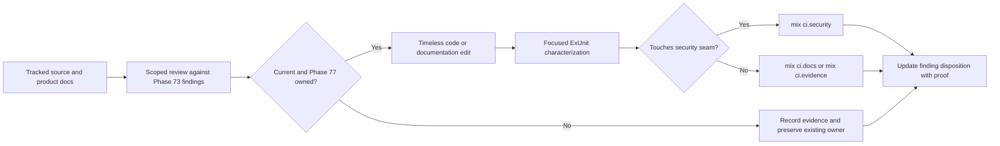

# Phase 77: Code and Documentation Craftsmanship - Research

**Researched:** 2026-09-26  
**Domain:** Elixir library maintenance, standalone documentation, deterministic governance checks  
**Confidence:** HIGH for current repository evidence; MEDIUM for implementation-level recommendations

<user_constraints>
## User Constraints (from CONTEXT.md)

### Locked Decisions

### Craftsmanship Cleanup Boundary
- **D-01:** Use the Phase 73 quality baseline as the starting queue. Fix Phase 77-owned findings and small clarity problems directly connected to them; avoid broad stylistic rewrites or behavior changes.
- **D-02:** Revalidate each baseline finding against the current tracked tree and current evidence before changing code or documents. Close items that are already resolved with concrete evidence, and keep findings assigned to other phases with their existing owners.

### Timeless Source and Documentation
- **D-03:** Replace temporary phase, plan, decision-code, UAT-path, and GSD narration in production comments, tests, and adopter-facing guidance with timeless contracts or rationale. Keep historical records under `.planning/` intact.
- **D-04:** Keep maintainer and governance references only where they explain an active repository contract. Adopter guides should not carry repository-only workflow instructions. Refresh `docs/jtbd_gap_map.md` as a current maintainer reference rather than retaining its phase-by-phase history.
- **D-05:** Keep comments only when they explain a contract, intent, or non-obvious security rationale. Remove phase and decision-code labels while preserving the invariants they were documenting, especially around signature verification and metadata trust.

### Acceptance Policy and Archive Boundary
- **D-06:** Keep deterministic automated acceptance mandatory. Correct false positives by distinguishing active incomplete-phase requirements from quoted or archival examples; do not exempt all `.planning/` content or delete archived history to make the check pass.
- **D-07:** Preserve intentional GSD and policy vocabulary in governance code and tests that enforce those contracts. A broad text search is candidate discovery, not sufficient evidence that a reference is stale.

### Finding and Artifact Disposition
- **D-08:** Close Phase 77-owned `QUAL-73-002`, `QUAL-73-003`, and `QUAL-73-006` with concrete evidence. Revalidate and classify `QUAL-73-004` before addressing its reported golden-fixture warnings; do not weaken fixture coverage.
- **D-09:** Preserve the adversarial proof and configured-certificate trust path for the resolved critical signature finding. Carry forward closure evidence for findings already owned by Phases 74 and 79; do not absorb Phase 78/79 work into this phase. Follow the Phase 73 severity policy for any still-open critical or high finding.
- **D-10:** Audit tracked paths for this phase. Remove an artifact only when evidence shows it is obsolete or duplicate; every retained exceptional artifact needs a clear owner. Unrelated untracked working-tree state is outside this requirement.

### the agent's Discretion
- Choose the exact files and small refactors needed to resolve the in-scope findings, after confirming each is still present.
- Choose focused deterministic evidence and the appropriate existing mandatory lane for each change.
- Preserve useful examples, golden outputs, and governance contracts when they are still owned and exercised.
- Stop when the Phase 77 findings are dispositioned and remaining changes would be broad aesthetic cleanup rather than adopter-significant value.

### Deferred Ideas (OUT OF SCOPE)

None — discussion stayed within Phase 77 scope. Findings assigned to later phases remain with those owners.
</user_constraints>

<phase_requirements>
## Phase Requirements

| ID | Description | Research Support |
|----|-------------|------------------|
| QUAL-02 | Production code and tests use clear names and justified abstractions, with redundant comments removed and non-obvious invariants preserved. | Scoped review of Phase 73 comment findings and current comment examples; retain comments that specify contracts, intent, or security reasoning. |
| QUAL-03 | Security-sensitive cleanup is protected by characterization and adversarial tests and preserves every existing security invariant. | Keep `test/security/xml/adversarial_crypto_test.exs` and the existing `mix ci.security` fresh-process gate; avoid changing signature semantics. |
| QUAL-04 | Standalone source and product documentation contain timeless rationale rather than internal phase, plan, decision-code, or GSD references. | Current tracked wording is verified in `signature.ex`, `guides/getting_started.md`, and `docs/jtbd_gap_map.md`; existing documentation contract tests run in `mix ci.docs`. |
| QUAL-05 | The tracked directory tree contains only intentional source, configuration, fixtures, documentation, and automation artifacts. | Reconcile tracked paths only; `test/governance/milestone_scope_test.exs` already owns tracked-artifact evidence and separates tracked paths from incidental worktree state. |
| QUAL-06 | Every critical or high-value audit finding is fixed, explicitly constrained by an approval checkpoint, or retained with a concrete rationale. | Phase 73 ledger has one resolved critical security finding and one high package-consumer finding owned by Phase 74; verify closure references and explicitly disposition Phase 77 medium/low rows. |
</phase_requirements>

The requirement IDs and descriptions above are copied verbatim from `.planning/REQUIREMENTS.md:44-48`: “**QUAL-02**: Production code and tests use clear names and justified abstractions, with redundant comments removed and non-obvious invariants preserved.”; “**QUAL-03**: Security-sensitive cleanup is protected by characterization and adversarial tests and preserves every existing security invariant.”; “**QUAL-04**: Standalone source and product documentation contain timeless rationale rather than internal phase, plan, decision-code, or GSD references.”; “**QUAL-05**: The tracked directory tree contains only intentional source, configuration, fixtures, documentation, and automation artifacts.”; “**QUAL-06**: Every critical or high-value audit finding is fixed, explicitly constrained by an approval checkpoint, or retained with a concrete rationale.” [VERIFIED: `.planning/REQUIREMENTS.md:44-48`]

The baseline severity policy's exact allowed values are “Critical, High, Medium, Low, and Informational”; its blocker states are “release-blocker”, “disposition-required”, “deferred”, and “resolved”. Apply its disposition rules verbatim when refreshing ledger rows. [VERIFIED: `.planning/phases/73-twin-contract-and-baseline/73-BASELINE.md:7-14`]

## Summary

This is a bounded quality closeout, not a feature phase. Use the Phase 73 ledger as the candidate queue, then reconcile every scoped row to current source and current ownership before editing. Current source still contains the clearest QUAL-73-002/003 examples: historical phase/decision narration in the metadata-root signature docs, repository-only CI/GSD guidance in the getting-started guide, and phase-by-phase history in the maintainer JTBD map. [VERIFIED: `.planning/phases/73-twin-contract-and-baseline/73-BASELINE.md:25-27`; `lib/relyra/security/signature.ex:49-65`; `guides/getting_started.md:147-157`; `docs/jtbd_gap_map.md:1-24,283-299`]

Revalidation changes the shape of two reported items. The active incomplete-phase checker only scans phase directories for phases still unchecked in the roadmap; a read-only scan of the current 77–79 directories found no prohibited markers or UAT artifacts, while the archival Phase 73 false-positive examples are no longer candidates. [VERIFIED: `test/docs/demo_guide_drift_test.exs:901-946`; `.planning/ROADMAP.md:48-54`; current static scan, 2026-09-26] The four warning paths in QUAL-73-004 have also drifted: only `relyra_snippet.exs` is currently tracked under the named golden config directory, and Mix project config ignores all `test/fixtures/` paths for its test-file warning filter. Confirm the resulting warnings with the phase's normal automated lane before closing the finding; do not rename/delete golden output based solely on the 2026-09-09 baseline. [VERIFIED: `mix.exs:9-17`; `git ls-files test/fixtures/demo_host/golden/config/*`, 2026-09-26; [CITED: `https://github.com/elixir-lang/elixir/blob/v1.19.5/lib/mix/lib/mix/tasks/test.ex`]

The high clean-room package finding and the critical signature-bypass finding are not open Phase 77 implementation work: Phase 74 records full/minimal/contracts consumer proofs and completed the package gate, while the security ledger records the critical item as resolved with adversarial and CI meta-gate proof. Phase 77 should carry those closure references forward and preserve the corpus, not reopen the fixes. [VERIFIED: `.planning/phases/74-clean-room-package-consumer/74-04-SUMMARY.md:94-103`; `docs/security_findings.md:1-16`; `.planning/phases/73-twin-contract-and-baseline/73-BASELINE.md:20,28`]

**Primary recommendation:** Plan small, evidence-linked edits only: remove time-bound narration while retaining each underlying contract, add/adjust focused characterization in the existing documentation and security owners where evidence shows a gap, and update baseline dispositions only after the appropriate deterministic lane proves closure. Do not add dependencies or change public APIs, defaults, cryptographic behavior, trust boundaries, or security posture. [VERIFIED: `77-CONTEXT.md` D-01–D-10; `AGENTS.md`]

## Architectural Responsibility Map

| Capability | Primary Tier | Secondary Tier | Rationale |
|------------|-------------|----------------|-----------|
| Production comment/name cleanup | API / Backend | — | The target code documents backend signature and metadata trust contracts; edits must preserve the existing crypto call path. |
| Standalone adopter documentation | API / Backend | Browser / Client | These guides describe how adopter applications integrate Relyra; this phase edits prose only, with no runtime UI work. |
| Documentation-policy regression checks | API / Backend | — | Mix/ExUnit checks enforce the repository's docs and acceptance policy in named CI aliases. |
| Tracked-artifact disposition | API / Backend | — | The governance owner reads Git-tracked paths and records ownership/disposition; incidental untracked state is explicitly outside this phase. |

## Standard Stack

### Core

| Library | Version | Purpose | Why Standard |
|---------|---------|---------|--------------|
| Elixir / Mix | Project constraint `~> 1.19`; source/docs checked against Mix 1.19.5 | Existing implementation, format/compile/test and named CI aliases | Already mandated by `mix.exs`; this phase needs no new stack. [VERIFIED: `mix.exs:9-17`; [CITED: `https://github.com/elixir-lang/elixir/blob/v1.19.5/lib/mix/lib/mix/tasks/test.ex`] |
| ExUnit | Bundled with the project's Elixir runtime | Focused deterministic contract and adversarial characterization | Existing docs, governance, and security test modules own these behaviors. [VERIFIED: `mix.exs:211-269`; `test/docs/demo_guide_drift_test.exs:901-946`] |

### Supporting

| Library | Version | Purpose | When to Use |
|---------|---------|---------|-------------|
| Mix `ci.docs` alias | In-repository alias | Documentation-contract tests and selected docs checks | For QUAL-02/QUAL-04 edits affecting standalone docs or the drift checker. [VERIFIED: `mix.exs:211-231`] |
| Mix `ci.security` alias | In-repository alias | Independent security suites, including adversarial crypto characterization | For any change touching signature/security-adjacent comments, tests, or acceptance. Each security suite is intentionally launched with its own `cmd mix test`. [VERIFIED: `mix.exs:243-269`] |
| Mix `ci.evidence` alias | In-repository alias | Evidence/governance contract validation | For changes to milestone ownership and tracked-artifact policy. [VERIFIED: `mix.exs:237-239`] |

The in-repo alias values quoted above are `"ci.docs"`, `"ci.security"`, and `"ci.evidence"` [VERIFIED: `mix.exs:211-243`].

### Alternatives Considered

| Instead of | Could Use | Tradeoff |
|------------|-----------|----------|
| Existing focused CI owners | Add a new linter or prose-scanning package | Adds dependency and maintenance surface without evidence it is needed; use narrow tests already owned by `ci.docs`/`ci.evidence`. |
| Current golden fixtures and adversarial corpus | Replace expected outputs or relax warning/test assertions | Risks masking installer drift or weakening crypto proof; retain and update evidence only when source behavior intentionally changes. |

**Installation:** None. Phase scope introduces no external packages.

## Architecture Patterns

### System Architecture Diagram



### Recommended Project Structure

Keep changes at the existing ownership seams; do not create a parallel checker or new package:

```text
lib/relyra/security/signature.ex          # timeless trust and ordering contracts
guides/                                    # adopter-facing guidance only
docs/jtbd_gap_map.md                       # current maintainer coverage map
test/docs/demo_guide_drift_test.exs        # documentation/acceptance policy owner
test/security/xml/adversarial_crypto_test.exs # permanent crypto characterization
test/governance/milestone_scope_test.exs   # finding and tracked-artifact owner
```

### Pattern 1: Replace Historical Labels With Their Invariant

**What:** Remove phase and decision labels from source comments while stating the behavior and trust boundary directly. Preserve exact security facts: metadata root verification precedes deep candidate parsing and uses operator-pinned metadata trust fingerprints, never assertion certificates. [VERIFIED: `lib/relyra/security/signature.ex:49-65`]

**When to use:** A comment refers to implementation history, but the behavior remains a current contract.

**Example:**

```elixir
@doc """
Verifies the metadata-root signature before deep candidate parsing, using
operator-pinned metadata trust certificates rather than assertion certificates.
"""
```

This is a wording skeleton, not a replacement for the complete current `@doc`; preserve the existing shared `do_verify/4` relationship and telemetry detail too. [VERIFIED: `lib/relyra/security/signature.ex:49-65`]

### Pattern 2: Classify Policy References by Their Active Owner

**What:** A match from a broad search is only a candidate. Keep deliberate GSD/policy vocabulary in governance checks and tests; determine whether the prose is adopter-facing, an active repository contract, or archival planning evidence before changing it. [VERIFIED: `77-CONTEXT.md` D-03–D-07; `test/docs/demo_guide_drift_test.exs:901-946`]

**When to use:** Refactoring the incomplete-phase checker or evaluating references in tests, demo prose, and `.planning/`.

**Example:**

```elixir
roadmap
|> incomplete_phase_numbers()
|> Enum.flat_map(&automation_policy_violations/1)
```

Keep acceptance deterministic and limited to active incomplete phases; do not exempt the entire planning tree or delete historical records. Add a regression fixture for archived examples only if the present live-repository test cannot establish that behavior reliably. [VERIFIED: `test/docs/demo_guide_drift_test.exs:901-946`]

The current literal rejection vocabulary is `marker <- ["<human-check>", "## Manual-Only Verifications", "status: human_needed"]` and the required artifact glob is `"*-UAT.md"`. [VERIFIED: `test/docs/demo_guide_drift_test.exs:931-946`]

### Pattern 3: Keep Each Security Alias Invocation Independent

**What:** Retain each `ci.security` suite as an explicit fresh `cmd mix test` process. Mix task aliases may otherwise deduplicate a repeated task within the same alias run; the source comment and `ci_gate_integrity_test.exs` explicitly guard against a hollow security lane. [VERIFIED: `mix.exs:243-269`]

**When to use:** Selecting validation commands or making a security characterization adjustment.

**Anti-Patterns to Avoid**

- **Delete all planning-vocabulary matches:** loses valid policy enforcement and archival evidence; disposition each hit by ownership and usage.
- **Rewrite `signature.ex` for readability without crypto proof:** comment cleanup must not change `do_verify/4`, configured certificate selection, parser path, or signature/digest verification.
- **Treat the 2026-09-09 fixture list as current:** three named baseline paths are absent from the current tracked glob result. Verify current tracked paths and CI output before any correction.
- **Add separate policy infrastructure:** the current owners are `demo_guide_drift_test.exs`/`ci.docs` and `milestone_scope_test.exs`/`ci.evidence`.

## Don't Hand-Roll

| Problem | Don't Build | Use Instead | Why |
|---------|-------------|-------------|-----|
| XMLDSig trust and verification | A new parser, trust resolver, canonicalizer, or crypto path to support cleanup | Existing `Relyra.Security.Signature`/`PureBeam`/`C14N` seams and adversarial corpus | Project invariants mandate one Saxy-derived parse path, configured IdP trust only, digest recomputation, and genuine public-key verification. [VERIFIED: `AGENTS.md`; `test/security/xml/adversarial_crypto_test.exs:1-36`] |
| Governance-policy matching | Broad repository text search as an acceptance oracle | Existing incomplete-phase check, narrowed by active roadmap scope and covered in `ci.docs` | Search hits include intentionally quoted/archive material; automated acceptance must stay deterministic without rejecting completed history. [VERIFIED: `test/docs/demo_guide_drift_test.exs:901-946`] |
| Golden installer expectations | Ad hoc generated snippets in place of checked-in outputs | Existing fixture and package-consumer contract owner | Golden files are used by install parity/clean-room checks; do not weaken them to eliminate warnings. [VERIFIED: `test/adoption/journey_01_install_parity_test.exs:33-54`; `.planning/phases/74-clean-room-package-consumer/74-04-SUMMARY.md:94-101`] |

**Key insight:** The hard part is classification, not tooling: distinguish timeless implementation contracts from temporary project narration and distinguish an actual defect from a baseline that has drifted. The scope and existing owners already encode the desired maintenance model. [VERIFIED: `77-CONTEXT.md` D-01–D-10; `73-BASELINE.md:7-14`]

## Common Pitfalls

### Pitfall 1: Removing the Comment and Its Security Rationale Together

**What goes wrong:** A historical Phase/D-code comment is removed, taking with it the required verify-before-deep-parse ordering or metadata trust source.

**Why it happens:** The historical label is mistaken for the entire comment's value.

**How to avoid:** Retain the contract in timeless prose; review `signature.ex` with the adversarial crypto corpus and preserve the configured trust path. [VERIFIED: `signature.ex:49-65`; `AGENTS.md`]

**Warning signs:** Any change moves or removes `do_verify/4`, the raw-binary guard/sole parser seam, candidate digest check, `:public_key.verify`, or configured certificate source.

### Pitfall 2: Letting a Broad Scan Rewrite Governance Vocabulary

**What goes wrong:** Intentional policy terms in governance code/tests are scrubbed, or `.planning/` history is exempted/deleted wholesale.

**Why it happens:** String presence is treated as proof that a reference is stale.

**How to avoid:** Use role/ownership context plus executable evidence. Current documentation checker derives candidate phases from unchecked roadmap rows and scans only those phase directories. [VERIFIED: `test/docs/demo_guide_drift_test.exs:901-946`]

**Warning signs:** A proposed rule searches all tracked Markdown without phase status/ownership context or adds manual acceptance to a new criterion.

### Pitfall 3: Correcting a Stale Warning Inventory Instead of the Current Tree

**What goes wrong:** Golden fixtures are renamed, deleted, or edited despite no longer producing warning candidates.

**Why it happens:** The baseline was a dated observation and its four paths do not match the current tracked state.

**How to avoid:** Use `git ls-files` plus the current `test_ignore_filters` configuration; let the normal automated command establish whether warnings remain. Current Mix 1.19.5 source classifies ignored candidates separately from both loaded and warned files. [VERIFIED: `mix.exs:16`; current `git ls-files`, 2026-09-26; [CITED: `https://github.com/elixir-lang/elixir/blob/v1.19.5/lib/mix/lib/mix/tasks/test.ex`]

**Warning signs:** The plan edits the single existing golden file before producing current warning output.

### Pitfall 4: Expanding Scope Into Later Owners

**What goes wrong:** Phase 77 starts CI optimization or remote GitHub/artifact cleanup.

**Why it happens:** Nearby findings are mistaken for part of the broad quality objective.

**How to avoid:** Keep PIPE-73-002 and artifact/release closeout work routed to Phase 78/79; Phase 77 may carry their disposition/evidence forward but not implement them. [VERIFIED: `73-BASELINE.md:24,29`; `77-CONTEXT.md` D-02, D-09]

## Code Examples

Verified source patterns for planning:

### Active Incomplete-Phase Policy

```elixir
roadmap
|> incomplete_phase_numbers()
|> Enum.flat_map(&automation_policy_violations/1)
```

Source: `test/docs/demo_guide_drift_test.exs:901-946`. It looks only at phase numbers still marked incomplete, then scans their phase Markdown for exact manual-only markers and required UAT artifacts. The research-time static scan found no violations in the current active incomplete phase directories (77–79); it did not run ExUnit. [VERIFIED: source and read-only scan, 2026-09-26]

### Existing Mix Warning Filter

```elixir
test_ignore_filters: [~r{^test/fixtures/}]
```

Source: `mix.exs:9-17`. Mix 1.19.5 source defines the candidate classification using `test_load_filters` and `test_ignore_filters`, with remaining paths warned. [VERIFIED: source line; [CITED: `https://github.com/elixir-lang/elixir/blob/v1.19.5/lib/mix/lib/mix/tasks/test.ex`]

## State of the Art

| Old Approach | Current Approach | When Changed | Impact |
|--------------|------------------|--------------|--------|
| Mix test discovery implicitly matched only `*_test.exs` | Since Elixir 1.19, the default candidate pattern matches Elixir files and `test_load_filters`/`test_ignore_filters` classify them | Elixir 1.19.0 | When evaluating fixture warning claims, account for the project's explicit ignore filter and use the currently installed project's CI command. [CITED: `https://github.com/elixir-lang/elixir/blob/v1.19.5/lib/mix/lib/mix/tasks/test.ex`] |

**Deprecated/outdated:** The Phase 73 warning count/path list is a historical baseline snapshot, not current tree proof. Do not alter or erase the archive; update its current finding disposition with revalidation evidence. [VERIFIED: `73-BASELINE.md:5,27`; current tracked-path scan, 2026-09-26]

## Environment Availability

Step 2.6: SKIPPED — no external runtime, service, CLI, or package installation is required. The existing project uses Mix/Elixir and repository-owned tests; Phase 77 introduces no external dependencies. [VERIFIED: phase scope; `mix.exs:9-17`]

## Validation Architecture

### Test Framework

| Property | Value |
|----------|-------|
| Framework | ExUnit (bundled with Elixir; project requires `~> 1.19`) |
| Config file | `mix.exs`; aliases define `ci.docs`, `ci.security`, and `ci.evidence` |
| Quick run command | `mix test test/docs/demo_guide_drift_test.exs --warnings-as-errors` |
| Full suite command | `mix qa` (project gate; do not run as research) |

### Phase Requirements → Test Map

| Req ID | Behavior | Test Type | Automated Command | File Exists? |
|--------|----------|-----------|-------------------|-------------|
| QUAL-02 | Comment/doc/source contracts remain clear and timeless | docs + unit | `mix ci.docs` | ✅ existing docs suite; add assertions only for a concrete changed contract |
| QUAL-03 | Security behavior/proof remains intact | security | `mix ci.security` | ✅ permanent corpus and fresh-process lane |
| QUAL-04 | Standalone docs and active acceptance policy contain no stale narration | docs | `mix test test/docs/demo_guide_drift_test.exs --warnings-as-errors` | ✅ existing; current sample has no active incomplete-phase violations |
| QUAL-05 | Only intentional tracked artifacts remain | governance | `mix ci.evidence` | ✅ governance owner exists; update disposition/evidence as needed |
| QUAL-06 | Baseline critical/high findings have evidenced resolution or retained disposition | governance + security | `mix ci.evidence` and `mix ci.security` for security proof | ✅ existing ledger validator and crypto proof owners |

### Sampling Rate

- **Per task commit:** run the owning focused docs/governance command; do not use broad scans as proof.
- **Per wave merge:** run `mix ci.docs`, `mix ci.evidence`, and `mix ci.security` if security-adjacent code/tests changed.
- **Phase gate:** `mix qa`, `mix test --warnings-as-errors`, `mix format --check-formatted`, and `mix ci.security` remain required by project instructions; do not collapse fresh-process security tasks into one `test` alias step.

### Wave 0 Gaps

- No framework/config gap identified. Existing owners cover docs, security, and tracked-artifact/evidence checks. Add a focused regression case only if the planner changes the current active-versus-archival matching logic or if the existing live-repository check cannot prove the desired archive behavior.

## Security Domain

Security enforcement remains enabled by default. This is not a security feature phase, but some cleanup is adjacent to XMLDSig trust rationale; preserve the existing proof and do not alter behavior.

### Applicable ASVS Categories

| ASVS Category | Applies | Standard Control |
|---------------|---------|-----------------|
| V2 Authentication | yes, preservation only | Keep cryptographic SAML signature verification and configured IdP certificates as the trust source. |
| V3 Session Management | no new behavior | No session behavior changes in scope. |
| V4 Access Control | no new behavior | No authorization behavior changes in scope. |
| V5 Input Validation | yes, preservation only | Preserve raw XML pre-parse size/DTD/entity guards and single Saxy parser seam. |
| V6 Cryptography | yes, preservation only | Preserve digest recomputation, `:public_key.verify`, algorithm policy, and adversarial regression coverage. |

### Known Threat Patterns for Elixir SAML/XML Security

| Pattern | STRIDE | Standard Mitigation |
|---------|--------|---------------------|
| Document `KeyInfo` supplies its own trust key | Spoofing / Elevation of privilege | Trust configured IdP certificates only. |
| Structure-only XMLDSig acceptance or digest not recomputed | Tampering / Spoofing | Preserve genuine signature and digest verification plus adversarial corpus. |
| Second parser or parser differential | Tampering | Keep the single Saxy parse path and raw-binary guards before it. |
| Trust mutation lacks atomic audit record | Repudiation | No bypass of the audit writer/co-commit path. |
| Production replay disabled or node-local-only | Replay / Spoofing | Preserve production replay protection and cluster-safe Ecto default. |

These controls are project invariants, quoted in `AGENTS.md`; this phase must not change them. [VERIFIED: project `AGENTS.md` read in this session]

## Project Constraints (from AGENTS.md)

- Follow the active GSD plan and state; do not implement outside plan scope or begin product work before a plan exists.
- Default to one researched recommendation. Escalate only for public API shape, default tightening, security posture, or real SemVer-major changes.
- Never trust document `KeyInfo`; use configured IdP certificates only.
- Preserve one Saxy parse path; no second XML parser or parser differentials.
- Run raw-binary DTD/entity and size guards before Saxy.
- Preserve digest recomputation and `:public_key.verify`; no structure-only signature acceptance.
- Trust mutations and audit rows co-commit in one Ecto transaction.
- Preserve required production replay protection; ETS warns in production and Ecto is the cluster-safe default.
- Do not bypass the listed crypto, XML, C14N, algorithm-policy, audit, or behavior seams.
- Keep `mix test --warnings-as-errors`, `mix ci.security`, and `mix format --check-formatted` green; `mix qa` must exit 0 before pushing.
- Keep every `mix ci.security` suite in a separate `cmd mix test` process; never weaken the adversarial crypto corpus; security-relevant code gets corpus rows.
- Every new acceptance criterion needs deterministic automated evidence in a mandatory CI lane. Do not add manual-only gates, human-needed completion, or required UAT for incomplete phases.
- Model external host/browser/Docker/service state with isolated fixtures, owned harnesses, or scheduled canaries; gaps remain automation gaps rather than manual approvals.
- Preserve historical UAT artifacts as archives, not as precedent for new manual gates.
- Use Conventional Commits and the required Co-Authored-By trailer; never hand-edit `CHANGELOG.md`.
- Never run `mix hex.publish` manually; Release Please publishes on release PR merge.

## Assumptions Log

| # | Claim | Section | Risk if Wrong |
|---|-------|---------|---------------|
| A1 | Phase 77 can close QUAL-73-006 from current active-phase scan evidence without changing its owner test, unless a focused fixture exposes a missing archive regression. | Summary / Validation | A latent scanner false positive may remain; the current static scan is not ExUnit execution. |
| A2 | The `test_ignore_filters` entry suppresses warnings for fixture candidates in the project's supported Mix version. | Summary / Pitfalls | A Mix-version behavior difference could leave warnings; confirm with normal CI output. |
| A3 | No new package or external dependency will be needed. | Standard Stack / Environment | Adding tooling would require package legitimacy review and dependency approval. |

## Open Questions (RESOLVED)

1. **Does current root QA still emit any golden fixture warning? — Resolved: QUAL-73-004 is closed by fresh green QA with no warning lines.**
   - Evidence: A fresh isolated `mix qa` run on 2026-09-26 exited 0 with 947 tests, 0 failures, and 10 excluded; the log contained no `warning` or `warn` lines. The run used Elixir 1.19.5/OTP 28 and an isolated `RELYRA_TEST_DATABASE` to avoid sharing the default test database with other local work. The historical Plan 77-03 run exited 2 after 942 tests with 4 failures and no warning lines (`77-03-SUMMARY.md`), so it was not green closure evidence.
   - Resolution: Current root QA produces no golden fixture discovery warning, and the old warning inventory is stale. No golden fixture was changed. Task 3 reruns `mix qa` after this research update and records that final status in the 77-04 summary.

2. **Does the policy contract need an isolated archive fixture? — Resolved disposition: existing evidence is sufficient for QUAL-73-006 absent a concrete false positive.**
   - Evidence: Plan 77-01's quoted-versus-active fixture and the live incomplete-phase check passed `mix ci.docs`; the checker derives scope from phases marked incomplete in the roadmap (`77-01-SUMMARY.md`, `test/docs/demo_guide_drift_test.exs:901-946`).
   - Resolution and limit: This establishes the current contract's distinction between active requirements and quoted examples, so a separate completed-archive fixture is unnecessary unless a concrete false positive appears. No isolated completed-archive fixture was run; preserve that evidence limit and retain rejection of prohibited markers in active incomplete phases.

## Sources

### Primary (HIGH confidence)

- `.planning/phases/77-code-and-documentation-craftsmanship/77-CONTEXT.md` — locked scope, decisions, and owners.
- `.planning/ROADMAP.md`, `.planning/REQUIREMENTS.md`, `.planning/STATE.md` — current phase scope and requirement mapping.
- `.planning/phases/73-twin-contract-and-baseline/73-BASELINE.md` — severity policy and original finding evidence/ownership.
- `lib/relyra/security/signature.ex`, `test/docs/demo_guide_drift_test.exs`, `test/security/xml/adversarial_crypto_test.exs`, `test/governance/milestone_scope_test.exs`, `mix.exs` — current implementation and verification owners, read during this session.
- `git ls-files` scoped inventory and read-only scan of active incomplete-phase documents, 2026-09-26.

### Secondary (MEDIUM confidence)

- [Mix 1.19.5 `Mix.Tasks.Test` source](https://github.com/elixir-lang/elixir/blob/v1.19.5/lib/mix/lib/mix/tasks/test.ex) — behavior of `test_ignore_filters` relevant to the stale fixture-warning report.
- `.planning/phases/74-clean-room-package-consumer/74-04-SUMMARY.md` — package consumer closure and automated evidence.

## Metadata

**Confidence breakdown:**
- Standard stack: HIGH — project Mix config is present; official Mix 1.19 docs checked.
- Architecture: HIGH — current test and security ownership seams were read directly.
- Pitfalls: MEDIUM — baseline revalidation is static and no tests were run during research.

**Research date:** 2026-09-26  
**Valid until:** 2026-10-26 for stable repository structure; revalidate live warning output before disposition.
