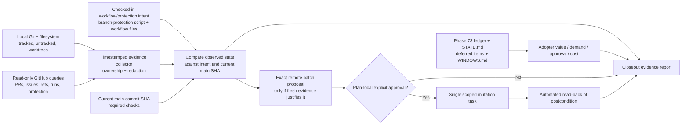

# Phase 79: Adopter-Ready Closeout - Research

**Researched:** 2026-09-29  
**Domain:** Repository hygiene, GitHub collaboration inventory, CI release readiness, and milestone residual-risk closeout  
**Confidence:** MEDIUM

<user_constraints>
## User Constraints (from CONTEXT.md)

### Locked Decisions

<!-- DATA_B8F1C24A_START -->
- **D-01:** Build a fresh, timestamped, read-only inventory of pull requests, issues, local and remote branches, required checks, workflow health, and branch protection before proposing any remote change. The Phase 73 snapshot is a lead to revalidate, not current state or current authorization.

- **D-02:** Classify tracked changes, untracked artifacts, and registered worktrees by ownership before declaring the repository clean. Preserve user-owned configuration such as .tool-versions; neither deleting every untracked path nor relying only on the Phase 78 receipt proves cleanliness.

- **D-03:** Base readiness on current required checks for the relevant main commit. Report external-provider canaries separately from deterministic merge gates; a historical receipt or a run on a dirty local checkout does not establish current main readiness.

- **D-04:** Revalidate the Phase 73 findings against current evidence and include existing deferred items and open cross-phase windows, including the Phase 76 concurrency automation gaps. Assess each remaining item against adopter value, demand, approval boundaries, and maintenance cost; an open window is not automatically a blocker.
<!-- DATA_B8F1C24A_END -->

### the agent's Discretion

<!-- DATA_93D15E6B_START -->
- Select the read-only evidence sources, report structure, and deterministic checks needed to establish these decisions. Keep evidence current, bounded, and redaction-safe. Any remote mutation still needs its own exact batch and explicit approval before it occurs.
<!-- DATA_93D15E6B_END -->

### Deferred Ideas (OUT OF SCOPE)

<!-- DATA_63D08A7F_START -->
No new ideas were raised. Existing demand-gated and future requirements remain governed by PROJECT.md and STATE.md; this phase evaluates their disposition without expanding its boundary.
<!-- DATA_63D08A7F_END -->
</user_constraints>

<phase_requirements>
## Phase Requirements

<!-- DATA_512C9F8A_START -->
| ID | Description | Research Support |
|----|-------------|------------------|
| REPO-01 | Main, tracked files, and registered worktrees end in an intentional clean state with no unexplained generated or scratch artifacts. [VERIFIED: `.planning/REQUIREMENTS.md:60`] | Use ownership-aware Git/worktree inventory and deterministic local source/clean-state evidence; retain evidence for user-owned paths and explain each artifact disposition. |
| REPO-02 | Maintainer can inspect a current inventory of pull requests, issues, branches, workflow health, and branch-protection state. [VERIFIED: `.planning/REQUIREMENTS.md:61`] | Record timestamped, read-only GitHub observations; cover all pages and distinguish current main-SHA checks from scheduled external canaries. |
| REPO-03 | Remote GitHub mutations are presented as an exact batch and performed only after explicit approval. [VERIFIED: `.planning/REQUIREMENTS.md:62`] | Existing governance expects plan-local approval and exact current/desired state, mutation, preflight, rollback, read-back, and same-target resume signal. Do not act on the 2026-09-09 candidate batch without fresh observations and approval. |
| EXIT-01 | Maintainer can inspect a final residual-risk assessment showing that remaining improvements are low-value, demand-gated, or costlier to maintain than the risk they retire. [VERIFIED: `.planning/REQUIREMENTS.md:68`] | Reconcile current Phase 73 finding evidence, deferred demand-gated requirements, and WINDOWS.md entries; record adopter value, demand, owner, approval boundary, maintenance cost, disposition, and revisit point. |
<!-- DATA_512C9F8A_END -->
</phase_requirements>

## Summary

Phase 79 is a feature-neutral closeout that joins local repository state, live collaboration evidence, required CI state, approval governance, and the remaining-risk ledger. The reliable plan is to make evidence collection read-only and timestamped, then compare current observations against checked-in intent. Local branch refs or historical reports alone cannot establish current remote state. The Phase 73 snapshot is explicitly dated 2026-09-09; Phase 78's receipt binds proof to source commit `7bc19dcf01c94771e165c1ccf6feff7b7e69f0d8` and is evidence for that source only. [VERIFIED: `.planning/phases/73-twin-contract-and-baseline/73-BASELINE.md:1-5, 45-49`; `.planning/phases/78-ci-efficiency-and-reliability/78-CLEAN-STATE-RECEIPT.json`, read this session]

Use Git CLI for local tracked/untracked/worktree facts, GitHub CLI and read endpoints for fresh remote inventory, `scripts/setup_branch_protection.sh --print-expected` for local protection intent, and the existing ExUnit governance seam for deterministic acceptance checks. GitHub's CLI documentation confirms `gh api` defaults to GET unless parameters change the method and supports `--paginate`; request output should remain bounded to reviewable metadata. [CITED: https://cli.github.com/manual/gh_api] No GitHub shared state was queried during this research. The only current remote observations belong in Phase 79 execution after the plan is active.

## Project Constraints (from AGENTS.md)

- Follow GSD scope: check `.planning/STATE.md`, read the active Phase 79 plan before implementation, and do not implement outside that plan. [VERIFIED: `CLAUDE.md:13-22`]
- Keep Phase 79 feature-neutral and preserve the project's SAML security invariants: configured IdP certificates only, the single Saxy parse path, raw-binary DTD/entity and size guards before parsing, real digest/signature verification, audit co-commit for trust mutations, and production replay protection. This closeout should not touch those product seams. [VERIFIED: `CLAUDE.md:38-47`; `.planning/phases/79-adopter-ready-closeout/79-CONTEXT.md:6-10`]
- Preserve security architecture seams and route related work only through their owned modules/behaviours; do not create parallel trust, parser, audit, or replay paths. [VERIFIED: `CLAUDE.md:49-58`]
- Before a push to `main`, require `mix qa`, warnings-as-errors tests, formatting, and `mix ci.security` green; preserve each security suite's fresh `cmd mix test` process and the adversarial crypto corpus. [VERIFIED: `CLAUDE.md:60-67`]
- Give every new acceptance criterion deterministic automated evidence in a mandatory CI lane. Do not add manual-only completion/UAT gates; model external services as fixtures, owned harnesses, or scheduled canaries and track any remaining automation gap explicitly. [VERIFIED: `CLAUDE.md:68-70`]
- Any remote GitHub change requires plan-local exact-batch authorization and approval before mutation, followed by automated read-back; this is part of the phase's locked decision and existing governance contract. [VERIFIED: `.planning/phases/73-twin-contract-and-baseline/73-CONTEXT.md`, D-09–D-12; `test/governance/milestone_scope_test.exs:4427-4505`]
- Use conventional commits if/when the orchestrator commits this research; do not hand-edit `CHANGELOG.md`, publish Hex manually, or alter release outputs. [VERIFIED: `CLAUDE.md:72-87`]

**Primary recommendation:** Keep collection/reporting read-only; bind main readiness to the live main commit SHA and its required checks; classify local state by ownership; and place any remote mutation in a separate, plan-local `remote_github` exact-batch checkpoint with deterministic preflight and post-mutation read-back. If approval is not granted, stop before mutation and preserve the evidence-backed disposition.

## Architectural Responsibility Map

| Capability | Primary Tier | Secondary Tier | Rationale |
|------------|-------------|----------------|-----------|
| Tracked/untracked file and worktree cleanliness | Operator workstation (local repository) | — | Local Git index, worktree, and filesystem state own this evidence; classify every path by owner before cleanup. |
| PR, issue, branch, workflow, and protection inventory | GitHub API / collaboration service | — | Live GitHub state is available from authenticated read-only GitHub API/CLI requests; the report is a derived, bounded record. |
| Main readiness and canary distinction | GitHub Actions / CI | GitHub API | Required check conclusions must correspond to the current main commit; provider health remains a separately reported scheduled canary. |
| Remote mutation authorization | Maintainer approval boundary | GitHub API | The maintainer checkpoint authorizes one exact target/payload; an automated postcondition check establishes acceptance. |
| Residual-risk assessment | Local planning records | — | The local planning ledger owns the durable status, evidence, owner, demand, and revisit record. |

## Standard Stack

### Core

| Library | Version | Purpose | Why Standard |
|---------|---------|---------|--------------|
| Git CLI | 2.41.0 detected 2026-09-29 | Local refs, tracked/untracked status, and registered worktree inventory | Existing repository state is managed by Git; `git worktree list --porcelain` exposes the registered-worktree inventory without network access. [VERIFIED: local `git --version` output, 2026-09-29] |
| GitHub CLI (`gh`) | 2.101.0 detected 2026-09-29 | Read-only pull request, issue, workflow, checks, branch, and protection inspection | Already installed; official CLI has typed commands plus `gh api` for repository REST endpoints. [VERIFIED: local `gh --version` output, 2026-09-29] [CITED: https://cli.github.com/manual/gh] |
| Mix / ExUnit | CI matrix: Elixir 1.19.5 with OTP 27 and 28; local Elixir/OTP not probed | Deterministic contract tests and mandatory CI acceptance | Existing evidence/governance contract is owned by `mix ci.evidence`, which runs `test/governance/milestone_scope_test.exs` in a fresh `cmd mix test` process. [VERIFIED: `.github/workflows/security-gates.yml:45-49`; `mix.exs:238-240`] |

### Supporting

| Library | Version | Purpose | When to Use |
|---------|---------|---------|-------------|
| `jq` | Recheck at execution | Select only allowlisted status/context fields from JSON API output | When a read-only inventory uses REST JSON and the report must omit irrelevant or sensitive response fields. **Version is not verified in this research.** |
| `scripts/setup_branch_protection.sh` | Repository source | Print branch-protection intent without applying it | Use `--print-expected` / `--print-expected-json` for comparison. The script's normal path performs a `PUT`; do not run it as inventory. [VERIFIED: `scripts/setup_branch_protection.sh:5-8, 69-95`] |
| `scripts/check_phase78_clean_state.sh` and Phase 78 receipt contract | Repository source | Reference source-bound deterministic evidence and exact source identity | Reuse the pattern where it adds value, but do not use the dated Phase 78 receipt as current main proof. [VERIFIED: `scripts/check_phase78_clean_state.sh:16-52`; Phase 79 D-02/D-03] |

### Alternatives Considered

| Instead of | Could Use | Tradeoff |
|------------|-----------|----------|
| `gh` typed commands plus `gh api` read endpoints | Custom GitHub API client or a new package | No repository need is established for a client dependency; the CLI already exists and exposes required read operations. A custom client expands auth, pagination, and credential handling. [CITED: https://cli.github.com/manual/gh_api] |
| Current-main SHA-linked CI evidence | A historical Phase 78 receipt or the most recent green run regardless of SHA | Historical receipts are source-bound and do not demonstrate current main readiness; a latest run may be for a different commit. [VERIFIED: Phase 79 D-03; `.planning/phases/78-ci-efficiency-and-reliability/78-CLEAN-STATE-RECEIPT.json`, read this session] |

**Installation:** None. This phase needs no external package installation. Git and `gh` are already present in this research environment; recheck the execution environment before planning commands that depend on them.

**Package Legitimacy Audit:** Not applicable; no package installation is recommended.

## Architecture Patterns

### System Architecture Diagram



### Recommended Project Structure

```text
.planning/phases/79-adopter-ready-closeout/
├── 79-RESEARCH.md               # planning guidance
├── 79-*-PLAN.md                 # planned tasks and checks (not yet authored)
└── execution evidence artifacts # exact, bounded filenames chosen by the plan

scripts/
├── check_phase78_clean_state.sh # prior source-bound evidence pattern
└── setup_branch_protection.sh   # expected-state printer and owner-controlled apply path

test/governance/
└── milestone_scope_test.exs     # ownership and exact-batch governance contract
```

### Pattern 1: Read-only, bounded inventory

**What:** Collect current local and remote observations once, include UTC collection time and target commit identity, paginate list endpoints, and persist only fields needed to explain state and decisions. Keep evidence redaction-safe. [VERIFIED: Phase 79 D-01 and discretion; `.planning/phases/73-twin-contract-and-baseline/73-BASELINE.md:47-51`] [CITED: https://cli.github.com/manual/gh_api]

**When to use:** For REPO-01/02 and the preflight before any possible remote change.

**Example:**

```bash
git status --short --untracked-files=all
git branch -vv
git branch -r -vv
git worktree list --porcelain

gh api --paginate --slurp "repos/{owner}/{repo}/pulls?state=all&per_page=100" --jq '[.[][] | {number, title, state, head: .head.ref, base: .base.ref, url: .html_url}]'
gh api --paginate --slurp "repos/{owner}/{repo}/issues?state=all&per_page=100" --jq '[.[][] | select(has("pull_request") | not) | {number, title, state, labels, url: .html_url}]'
gh workflow list --all
gh api --paginate "repos/{owner}/{repo}/commits/$MAIN_SHA/check-runs?filter=latest&per_page=100" --jq '.check_runs[] | {name, status, conclusion, completed_at, head_sha}'
gh api "repos/{owner}/{repo}/commits/$MAIN_SHA/status" --jq '{state, statuses: [.statuses[] | {context, state, updated_at, target_url}]}'
gh api --paginate "repos/{owner}/{repo}/actions/runs?head_sha=$MAIN_SHA&per_page=100" --jq '.workflow_runs[] | {name, status, conclusion, created_at, head_sha, html_url}'
gh api --paginate "repos/{owner}/{repo}/branches"
gh api "repos/{owner}/{repo}/branches/main/protection"
./scripts/setup_branch_protection.sh --print-expected
```

These are command-shape examples, not a request to run them during research. The phase owner should verify CLI options and available fields at execution, bind CI queries to the currently observed `main` SHA, and avoid logging auth status, tokens, full environment output, or unrelated workflow payloads. `--paginate` fetches every result page; `--slurp` wraps page results for reduction. Use both check runs and combined commit status when the live protection contexts require it: the REST endpoints expose distinct check-run and status-context data. Check-runs for a ref can be paginated and filtered to latest completed runs; GitHub documents a 1,000-check-suite endpoint limit, so inspect the endpoint contract if an exceptional count is reached. [CITED: https://docs.github.com/en/rest/checks/runs; https://docs.github.com/en/rest/commits/statuses; https://docs.github.com/en/rest/actions/workflow-runs; https://cli.github.com/manual/gh_api]

### Pattern 2: Exact batch authorization and acceptance separation

**What:** A remote operation is plan-local and names the captured current state, desired state, affected checks, one allowed mutation command, read-only preflight, rollback to the captured state, read-back command, and resume signal. Approval occurs before the first mutation. Acceptance requires the automated postcondition read-back; approval itself does not prove success. [VERIFIED: `.planning/phases/73-twin-contract-and-baseline/73-CONTEXT.md`, D-09–D-12; `test/governance/milestone_scope_test.exs:4427-4505`]

**When to use:** Only if the fresh inventory identifies a specific actionable GitHub discrepancy. Do not presume the Phase 73 candidate batch is still necessary or authorized.

**Example:**

```text
current_state: captured repository/branch/protection and check set
desired_state: same repository/branch with the exact approved protection state
preflight: read current protection immediately before mutation
mutation: one repository-owned operation whose payload equals desired_state
rollback: reapply captured current_state, after its own authorization
read_back: query same target and assert exact affected-check postcondition
resume_signal: exact approval phrase bound to this target and batch
```

Governance validation currently requires exactly one non-placeholder state and command field, confirms current/desired target identity, ties mutation payload to desired state, ties rollback to captured state, and binds read-back and resume signal to the same target. [VERIFIED: `test/governance/milestone_scope_test.exs:4427-4505`; `.planning/phases/73-twin-contract-and-baseline/73-CONTEXT.md`, D-11]

### Pattern 3: Ownership-aware local cleanliness

**What:** Inventory tracked edits, untracked paths, ignored/generated candidates, local branches, remote-tracking branches, and registered worktrees. Classify each relevant path/worktree as task-owned, user-owned, generated, obsolete/duplicate, or unresolved before cleanup. Preserve `.tool-versions` when user-owned, and use a source-bound receipt only for the exact source it describes. [VERIFIED: Phase 79 D-02; `.planning/phases/73-twin-contract-and-baseline/73-BASELINE.md:28-29`; `.planning/phases/78-ci-efficiency-and-reliability/78-CLEAN-STATE-RECEIPT.json`, read this session]

**When to use:** REPO-01 closeout and immediately before any final cleanliness claim.

**Example:** Pair `git status --short --untracked-files=all`, `git ls-files`, `git check-ignore -v <path>`, and `git worktree list --porcelain`; link each disposition to path owner/evidence. Use the Phase 78 source digest/receipt contract as a reference rather than broad deletion or `git clean`.

### Anti-Patterns to Avoid

- **Treating Phase 73 or 78 evidence as current state:** It is dated/source-bound. Take a new live inventory and associate main check conclusions with the observed main SHA. [VERIFIED: Phase 79 D-01/D-03]
- **Treating local remote-tracking refs as authoritative remote inventory:** They can lag remote state. Query GitHub read-only endpoints during execution and record observation time. [ASSUMED: operational risk; validate the exact execution approach before use.]
- **Inferring main readiness from a green canary or arbitrary latest workflow run:** Determine required contexts from current branch protection and inspect the current main commit's required runs/check conclusions; keep provider canaries separate. [VERIFIED: Phase 79 D-03; `.planning/phases/78-ci-efficiency-and-reliability/78-CONTEXT.md`, D-07/D-11]
- **Using `setup_branch_protection.sh` as an inventory command:** Its normal path sends `gh api -X PUT`; only `--print-expected` and `--print-expected-json` are read-only modes. [VERIFIED: `scripts/setup_branch_protection.sh:69-95`]
- **Deleting all untracked/generated candidates or declaring clean based only on tracked files:** Resolve ownership and registered worktrees first; preserve user-owned state and explain remaining ignored/build outputs. [VERIFIED: Phase 79 D-02]
- **Combining authorization and acceptance:** A permission checkpoint does not establish the postcondition. Keep the read-back as deterministic evidence. [VERIFIED: `.planning/phases/73-twin-contract-and-baseline/73-CONTEXT.md`, D-12]
- **Adding a manual-only release criterion:** New acceptance criteria need deterministic automated evidence in a mandatory lane; unautomatable host/provider gaps remain explicit automation gaps or scheduled canaries. [VERIFIED: `CLAUDE.md:68-70`; `.planning/STATE.md:69-74`]

## Don't Hand-Roll

| Problem | Don't Build | Use Instead | Why |
|---------|-------------|-------------|-----|
| GitHub REST authentication, endpoint request, and pagination | A new GitHub client/package for this closeout | Existing `gh` CLI and `gh api --paginate` read endpoints | It is installed and its official manual documents authenticated requests and pagination; no custom client capability is needed. [VERIFIED: local `gh --version`; CITED: https://cli.github.com/manual/gh_api] |
| Branch-protection expected-state serialization | A second hand-maintained list of required-check names | `scripts/setup_branch_protection.sh --print-expected-json` as read-only expected-state source | Keeps comparison aligned with the existing owner-controlled apply script. The mutation path must remain separately approved. [VERIFIED: `scripts/setup_branch_protection.sh:18-23, 46-78`] |
| Repository/worktree clean proof | A one-off broad deletion command or a claim based only on the Phase 78 receipt | Git inventory plus ownership dispositions and appropriate source-bound checks | Local ownership differs; the user-owned `.tool-versions` is explicitly protected by D-02, and the Phase 78 receipt is bound to its source commit. [VERIFIED: Phase 79 D-02/D-03] |
| Approval protocol | A prose “approved” flag detached from concrete state | Existing exact-batch grammar in `test/governance/milestone_scope_test.exs` | It checks exact target, payload, preflight, rollback, read-back, and resume signal rather than generic approval language. [VERIFIED: `test/governance/milestone_scope_test.exs:4427-4505`] |

**Key insight:** The hard part is provenance and ownership, not API mechanics: every conclusion must identify what was observed, when, against which source/commit, who owns the state, and whether the evidence is deterministic CI or an external canary.

## Common Pitfalls

### Pitfall 1: Stale inventory presented as live

**What goes wrong:** A dated snapshot or old remote-tracking ref is described as the current state.  
**Why it happens:** Phase 73 correctly captured historical findings that later readers can accidentally reuse as present truth.  
**How to avoid:** Generate fresh UTC timestamps and re-query PRs, issues, remote branches, workflow state, main checks, and protection during execution.  
**Warning signs:** The report repeats Phase 73's 2026-09-09 counts/branch-protection discrepancy without new API output. [VERIFIED: `.planning/phases/73-twin-contract-and-baseline/73-BASELINE.md:1-5, 20-22, 45-49`; Phase 79 D-01]

### Pitfall 2: CI conclusion belongs to the wrong commit or lane

**What goes wrong:** A green run for a prior commit or a scheduled provider canary is treated as proof that current main is ready.  
**Why it happens:** Different workflows and checks have different triggers and owners; the Phase 78 receipt proves its bound source only.  
**How to avoid:** Resolve current main SHA first, read the current required check set from remote protection, then inspect check conclusions for that SHA. Report provider canaries in their own status category.  
**Warning signs:** Readiness has no SHA, check name, run link/ID, timestamp, or required-versus-canary label. [VERIFIED: Phase 79 D-03; `.planning/phases/78-ci-efficiency-and-reliability/78-CONTEXT.md`, D-07/D-11; `78-CLEAN-STATE-RECEIPT.json`, read this session]

### Pitfall 3: Cleanliness declared before ownership is known

**What goes wrong:** A user config, worktree, or generated artifact is deleted or an unexplained path remains while report says clean.  
**Why it happens:** `git status` alone does not explain ownership, and tracked-only receipts do not account for worktrees/untracked/ignored state.  
**How to avoid:** Link each tracked delta, untracked path, candidate scratch artifact, and registered worktree to an owner and disposition. Preserve `.tool-versions`; do not apply bulk clean/delete commands.  
**Warning signs:** “Clean” means only no tracked diff, or the report contains no worktree listing and no untracked-path disposition. [VERIFIED: Phase 79 D-02]

### Pitfall 4: Proposed remote repair expands after approval

**What goes wrong:** A checkpoint for one branch-protection change is treated as permission to close issues, label/comment, merge, delete branches, or alter workflows.  
**Why it happens:** A list of related tasks is mistaken for a single authorized batch.  
**How to avoid:** Bind approval to exactly one repository/branch and exact current/desired state, command/payload, affected checks, preflight, rollback, read-back, and resume signal. Any additional operation needs its own checkpoint.  
**Warning signs:** Wildcard targets, shell composition, placeholder payloads, unbounded loops, or approval text that is not specific to the exact remote state. [VERIFIED: `.planning/phases/73-twin-contract-and-baseline/73-CONTEXT.md`, D-09–D-12; `test/governance/milestone_scope_test.exs:4427-4505`]

### Pitfall 5: Dated residual risks become either assumed blockers or silently disappear

**What goes wrong:** Open Phase 76 windows are automatically treated as release blockers, or deferred Phase 73 findings disappear without a current disposition.  
**Why it happens:** State labels are mistaken for adopter-impact analysis.  
**How to avoid:** Reproduce/refresh evidence, name owner and revisit point, assess adopter value/demand/approval boundary/maintenance cost, then document a bounded disposition. Keep demand-gated future requirements and open automation gaps visible.  
**Warning signs:** The risk report has a naked open/closed column, omits the two Phase 76 concurrency gaps, or treats an old snapshot as fresh evidence. [VERIFIED: Phase 79 D-04; `.planning/WINDOWS.md`, rows 29-30; `.planning/STATE.md`, Deferred Items]

## Code Examples

### Read-only query conventions

```bash
# Resolve main identity before checking conclusions.
gh api "repos/{owner}/{repo}/commits/main" --jq '{sha: .sha, committed_at: .commit.committer.date}'

# Inspect check runs and workflow executions on that exact main SHA.
gh api --paginate --slurp "repos/{owner}/{repo}/commits/$MAIN_SHA/check-runs?filter=latest&per_page=100" --jq '[.[][].check_runs[] | {name, status, conclusion, completed_at, head_sha}]'
gh api "repos/{owner}/{repo}/commits/$MAIN_SHA/status" --jq '{state, statuses: [.statuses[] | {context, state, updated_at, target_url}]}'
gh workflow list --all
gh api --paginate "repos/{owner}/{repo}/actions/runs?head_sha=$MAIN_SHA&per_page=100" --jq '.workflow_runs[] | {name, status, conclusion, created_at, head_sha, html_url}'

# Inspect branch-protection state and compare with checked-in intent.
gh api "repos/{owner}/{repo}/branches/main/protection"
./scripts/setup_branch_protection.sh --print-expected-json
```

**Source:** [GitHub CLI `gh api`](https://cli.github.com/manual/gh_api), [REST API: check runs](https://docs.github.com/en/rest/checks/runs), [REST API: commit statuses](https://docs.github.com/en/rest/commits/statuses), and [REST API: branch protection](https://docs.github.com/en/rest/branches/branch-protection). Check-run inventory needs repository Checks read permission; combined status needs Commit statuses read permission; branch-protection inspection needs repository Administration read permission. A 404/permission error is an evidence gap, not proof of missing checks or unprotected state. [CITED: https://docs.github.com/en/rest/checks/runs; https://docs.github.com/en/rest/commits/statuses; https://docs.github.com/en/rest/branches/branch-protection]

### Deterministic current-state fixture contract

Represent API observations as small redacted JSON fixtures keyed to explicit collection time, target SHA, endpoint class, and observation status. The tests should reject incomplete pagination, mismatched main SHA, unrecognized check state, unexpected response fields where a closed schema is used, and any attempted mutation in a read-only collection path. Extend the existing governance owner and attach it to `mix ci.evidence`; do not rely on a human-only report review as acceptance. [VERIFIED: `mix.exs:238-240`; `.github/workflows/security-gates.yml:97-104`; `CLAUDE.md:68-70`]

## State of the Art

| Old Approach | Current Approach | When Changed | Impact |
|--------------|------------------|--------------|--------|
| Phase 73's one-time GitHub snapshot | Fresh, timestamped read-only inventory at closeout | Phase 79 locked decision, 2026-09-29 | Old PR/issue/branch/protection findings are leads only; derive actions from current state. [VERIFIED: Phase 79 D-01] |
| Phase 78 receipt treated as present release truth | Source-bound cold-state receipt plus independent live main-SHA required-check inspection | Phase 78 completion, 2026-09-29 | Local reproducibility and remote merge readiness become separate evidence categories. [VERIFIED: Phase 79 D-03; `78-CLEAN-STATE-RECEIPT.json`, read this session] |
| Cleanup inferred from tracked diff or deleting scratch candidates | Explicit ownership ledger for tracked/untracked/worktree entries | Phase 79 locked decision, 2026-09-29 | User-owned configuration and retained artifacts stay intentional. [VERIFIED: Phase 79 D-02] |

**Deprecated/outdated:** The 2026-09-09 GitHub observation in Phase 73 is historical inventory only; it cannot support current count or current authorization claims. [VERIFIED: `.planning/phases/73-twin-contract-and-baseline/73-BASELINE.md:1-5, 20-22, 45-49`]

## Environment Availability

| Dependency | Required By | Available | Version | Fallback |
|------------|------------|-----------|---------|----------|
| Git CLI | Local refs, status, worktree inspection | ✓ | 2.41.0 (2026-09-29) | None; local inventory cannot replace remote GitHub facts. |
| GitHub CLI (`gh`) | Live read-only remote inventory and possible separately approved batch | ✓ | 2.101.0 (2026-09-29) | Official REST calls via an owner-provided authenticated environment; authorization and permissions still required. |
| GitHub network/auth | Current PR/issue/branch/workflow/protection state | Not probed by design | — | Do not use cached Phase 73 values; record access failure as an unresolved evidence gap and continue local work. |
| `jq` | JSON field selection for examples/receipts | Not probed | — | Use `gh --json` / `--jq` or existing repository-owned JSON tooling, after verifying command availability. |
| Mix / Elixir | Deterministic governance check at execution | Not probed during this read-only research | — | Run the repo's explicit `.tool-versions`/asdf toolchain or the project's documented CI toolchain when the plan is active. |

## Validation Architecture

### Test Framework

| Property | Value |
|----------|-------|
| Framework | ExUnit, repository-configured |
| Config file | `mix.exs`; workflow definitions in `.github/workflows/security-gates.yml` |
| Quick run command | `mix ci.evidence` (existing governance/evidence contract lane; not run in this research) |
| Full suite command | `mix qa` and `mix ci.security` per `CLAUDE.md` before pushing; final main readiness also requires live remote current-SHA check evidence |

### Phase Requirements → Test Map

| Req ID | Behavior | Test Type | Automated Command | File Exists? |
|--------|----------|-----------|-------------------|-------------|
| REPO-01 | Ownership-aware tracked/untracked/worktree classifier rejects unexplained cleanup/clean-state claims and preserves user-owned paths | unit/contract | `mix ci.evidence` | ✅ `test/governance/milestone_scope_test.exs`; add fixtures if Phase 79 introduces new ownership-report schema |
| REPO-02 | Inventory formatter/parser covers PRs, issues, refs, workflow health, required checks, branch protection, pagination, timestamps, and redaction with deterministic fixtures | unit/contract | `mix ci.evidence` | ⚠️ Existing validator owner exists; inspect for Phase 79 coverage and add missing fixtures in plan |
| REPO-03 | Exact-batch grammar binds approval, command, affected checks, preflight, rollback, and read-back to one current remote target | governance contract | `mix ci.evidence` | ✅ `test/governance/milestone_scope_test.exs` has exact-batch validation; plan should add/retain adversarial controls for any new batch operation |
| EXIT-01 | Risk parser/report rejects omitted ownership, evidence, disposition, or revisit data; includes deferred items and open windows | unit/contract | `mix ci.evidence` | ⚠️ Existing baseline findings validator exists; inspect Phase 79 required fields/coverage and add deterministic fixtures if the report schema expands |

Live GitHub observations are operational evidence and are not reproduced against shared state by local CI. Keep deterministic acceptance in fixtures/contracts under a mandatory lane; mark current remote availability as external state and re-read it during execution. No tests were run in this research.

### Sampling Rate

- **Per task commit:** `mix ci.evidence` when changing governance/evidence contracts; use a focused ExUnit selector during implementation as appropriate.
- **Per wave merge:** `mix ci.evidence` plus the owned focused validation commands declared by the plan.
- **Phase gate:** current-main required check evidence and mandatory CI status; local `mix qa`, warnings-as-errors tests, formatting, and `mix ci.security` remain green before a push under project rules.

### Wave 0 Gaps

- [ ] Inspect current REPO-01/02/03 and EXIT-01 coverage in `test/governance/milestone_scope_test.exs`; extend fixture coverage for any new report schema, pagination/error cases, timestamp/SHA binding, and read-only/mutation separation.
- [ ] Identify the exact mandatory lane if new tests are added; existing `mix ci.evidence` is wired in `.github/workflows/security-gates.yml`.
- No external service credential or connection may be probed during research; live state collection belongs to an active Phase 79 execution task.

## Security Domain

This phase has no SAML product-path changes. Security concerns are operational access, data minimization, and preventing unauthorized remote writes. OWASP identifies ASVS as a basis for verifying application and technical controls; its current chapter list distinguishes authentication, session management, access control, validation, and stored cryptography. [CITED: https://owasp.org/projects/asvs; https://devguide.owasp.org/en/06-verification/01-guides/03-asvs/]

### Applicable ASVS Categories

| ASVS Category | Applies | Standard Control |
|---------------|---------|-----------------|
| V2 Authentication | yes | Use the existing GitHub CLI auth context; never expose token values or copy them into artifacts. Require read permission for inventory and narrowly scoped administrative permission only if an explicitly approved protection batch is planned. [CITED: https://docs.github.com/en/rest/branches/branch-protection] |
| V3 Session Management | no | No application session lifecycle is introduced by this repository-closeout phase. |
| V4 Access Control | yes | Keep inventory read-only and separate it from owner-controlled mutation; bind any write to explicit plan-local approval and a single exact target/payload. [VERIFIED: `test/governance/milestone_scope_test.exs:4427-4505`; CITED: https://docs.github.com/en/rest/branches/branch-protection] |
| V5 Input Validation | yes | Validate imported inventory/fixture schemas, reject unknown or incomplete states, and do not compose shell commands from remote response fields. [VERIFIED: `test/governance/milestone_scope_test.exs:4415-4521`] |
| V6 Stored Cryptography | no new control | Do not add custom crypto or store credentials; existing Relyra SAML cryptographic invariants remain untouched. [CITED: https://devguide.owasp.org/en/06-verification/01-guides/03-asvs/] |

### Known Threat Patterns for GitHub/CI governance

| Pattern | STRIDE | Standard Mitigation |
|---------|--------|---------------------|
| A stale or partial inventory drives an unsafe change | Tampering | Timestamp evidence, paginate, capture current state immediately before any approved mutation, then read it back. |
| Token/secret or sensitive API payload leaks into an artifact | Information disclosure | Allowlist fields; redact secrets and omit body/log contents not needed for the finding. Follow bounded Phase 78 artifact practice. |
| Approval is reused for another branch or expanded operation | Elevation of privilege | One exact target and batch per plan-local checkpoint; reject shell composition and target/payload mismatches. |
| Current main's required checks are mistaken for scheduled provider health | Repudiation / Tampering | Report deterministic required merge gates separately from external canary results, each with source SHA and timestamp. |

## Assumptions Log

| # | Claim | Section | Risk if Wrong |
|---|-------|---------|---------------|
| A1 | A future local fixture/report contract is the right deterministic owner for live GitHub inventory formatting; current tests may need a more specific owner after inspection. | Validation Architecture | Inventory completeness, pagination handling, redaction, or SHA binding could lack mandatory automated regression coverage. |
| A2 | Check-run records plus combined commit statuses will cover all required contexts returned by the live branch-protection response. | Standard Stack / Code Examples | A status provider/context may appear in only one API view; compare each required context explicitly and report any missing observation. |
| A3 | `jq` is available in the phase execution environment. | Environment Availability | JSON reduction examples need to use available `gh --jq` or repository tooling instead. |

## Open Questions

1. **What exact GitHub state and candidate remote batch will exist when Phase 79 executes?**
   - Planning resolution: **RESOLVED** — Plan `79-01-PLAN.md` Tasks 1 and 3 collect fresh, timestamped read-only state; Plan `79-02-PLAN.md` Task 2 can propose an exact batch only from that state. Phase 73's values remain historical. The actual live GitHub state is still unknown until Phase 79 execution.
   - What we know: Phase 73 recorded a branch-protection discrepancy on 2026-09-09 and named a possible owner-controlled repair. [VERIFIED: `.planning/phases/73-twin-contract-and-baseline/73-BASELINE.md:20-22, 45-49`]
   - What's unclear: Current open PRs/issues, branch refs, disabled workflows, required checks, and protection state; none were queried during research by instruction.
   - Recommendation: Re-inventory read-only after the Phase 79 plan is active. Any exact batch must be built from those observations and await its own explicit approval.

2. **Does the current governance test already cover the selected inventory report schema?**
   - Planning resolution: **RESOLVED** — Plan `79-01-PLAN.md` Task 1 inspects `test/governance/milestone_scope_test.exs` before edits, then Tasks 1 and 2 add only missing deterministic fixtures for the selected report schema, pagination, timestamp, workflow state, and main-SHA behavior in the existing `mix ci.evidence` owner.
   - What we know: The existing test owns baseline/artifact governance and exact-batch checks; `mix ci.evidence` includes it. [VERIFIED: `mix.exs:238-240`; `.github/workflows/security-gates.yml:97-104`]
   - What's unclear: Coverage for a new Phase 79 report schema, pagination errors, timestamps, and main-SHA linkage was not exhaustively audited during this domain research.
   - Recommendation: Inspect the exact behaviors during planning and create only the fixture/test deltas needed for deterministic coverage.

## Sources

### Primary (HIGH confidence)

- `.planning/phases/79-adopter-ready-closeout/79-CONTEXT.md` — locked phase boundary and decisions, read this session.
- `.planning/ROADMAP.md` and `.planning/REQUIREMENTS.md` — Phase 79 success criteria and requirements, read this session.
- `.planning/STATE.md`, `.planning/WINDOWS.md`, Phase 73 context/baseline, Phase 77 context, Phase 78 context/verification/receipt — current project decisions and historic evidence boundaries, read this session.
- `scripts/setup_branch_protection.sh`, `scripts/check_phase78_clean_state.sh`, `test/governance/milestone_scope_test.exs`, `mix.exs`, `.github/workflows/security-gates.yml`, `CLAUDE.md` — repository implementation and automation owners, read this session.

### Secondary (MEDIUM confidence)

- [GitHub CLI `gh api`](https://cli.github.com/manual/gh_api) — authenticated API request semantics, GET/POST default behavior, pagination, response filtering.
- [GitHub CLI `gh run list`](https://cli.github.com/manual/gh_run_list) — filters, disabled workflow inclusion, commit selection.
- [GitHub CLI `gh workflow list`](https://cli.github.com/manual/gh_workflow_list) — workflow inventory command.
- [GitHub REST API: branch protection](https://docs.github.com/en/rest/branches/branch-protection) — read endpoint and permission requirements.
- [GitHub REST API: workflow runs](https://docs.github.com/en/rest/actions/workflow-runs) and [branches](https://docs.github.com/en/rest/branches/branches) — remote state endpoint categories.
- [GitHub REST API: check runs](https://docs.github.com/en/rest/checks/runs) — list check runs for a Git reference, including SHA-bound status/conclusion and pagination.
- [GitHub REST API: commit statuses](https://docs.github.com/en/rest/commits/statuses) — combined commit status by ref/SHA and its `context` entries.
- [OWASP ASVS](https://owasp.org/projects/asvs) and [OWASP Developer Guide ASVS](https://devguide.owasp.org/en/06-verification/01-guides/03-asvs/) — security verification scope and category names.

## Metadata

**Confidence breakdown:**
- Standard stack: MEDIUM — local CLI versions and repository test owners are verified; GitHub endpoint semantics are from official documentation, while live credentials/state were intentionally not probed.
- Architecture: HIGH — phase responsibilities and ownership boundaries come from the locked context, repository policy, and existing source.
- Pitfalls: HIGH — stale evidence, approval separation, ownership, and canary boundaries are explicit decisions with current in-repository owners.

**Research date:** 2026-09-29  
**Valid until:** 2026-10-29 for stable repository patterns; live GitHub state has no durable validity and must be refreshed immediately during Phase 79 execution.
